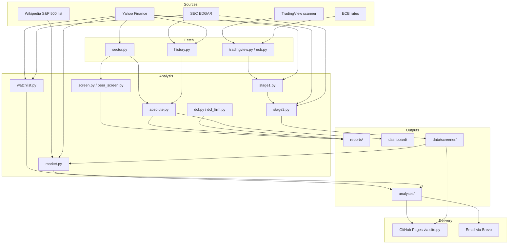

# Architecture

The project is a set of Python scripts that pull free market data, screen and value
companies, and turn the results into reports, dated PDFs, a public web page and an evening
email. Claude runs the scripts in Claude Code sessions and writes the judgement (notes,
verdicts, reports); the scripts produce the numbers.

There is no server and no database. State is files in the repository (configuration, saved
data, dated analyses, reports) plus a local cache that is never committed.

## Layers

Data moves through five layers, top to bottom.

```
 1. DATA SOURCES (all free; FMP exists but is not used)
    Yahoo Finance       SEC EDGAR             TradingView        ECB          Wikipedia
    (yfinance)          companyfacts, frames  screener (scan)    FX rates     S&P 500 list
        |                   |                     |                 |            | (by hand)
        v                   v                     v                 v            v
 2. FETCH AND CACHE
    src/stock_analysis/fetch.py      -> data/<SYMBOL>/            (one company, Yahoo)
    analysis/sector.py               -> data/sector/utilities.csv, history_yahoo.csv
    analysis/history.py              -> data/sector/history.csv   (.cache/sec/ raw files)
    src/stock_analysis/tradingview.py, ecb.py
                                     -> .cache/screener/*.pkl     (cached for the day)
    config/market_universe.csv       (S&P 500 members for market breadth)
        |
        v
 3. ANALYSIS MODULES
    absolute.py (step 1)  screen.py  peer_screen.py  dcf.py  dcf_firm.py  compare.py
    valuation.py  debt.py  debt_to_ebitda.py
    stage1.py -> stage2.py (run together by screener.py)
    watchlist.py (own-history P/E, entry price)   market.py   stock_analysis.metrics
        |
        v
 4. OUTPUTS
    reports/NN-*.md                 numbered reports (written by Claude)
    dashboard/*.html                sector dashboards (published as Claude artifacts)
    data/screener/stage1.csv, top.csv, YYYY-MM-DD.csv
    analyses/<SYMBOL>/YYYY-MM-DD_HHMM.pdf, runs.csv, README.md, notes.md
    analyses/market/, analyses/summaries/, analyses/README.md
    docs/METRICS.md                 generated from config/metrics.toml
        |
        v
 5. DELIVERY
    git push to main  ->  GitHub Actions (pages.yml) -> analysis/site.py -> GitHub Pages
    analysis/send_email.py -> Brevo API -> email to Babak (body + every PDF attached)
    Claude artifacts (dashboards), published by hand from a session
```

The same picture as a Mermaid diagram (GitHub renders it):



## Module map

### `src/stock_analysis/` (the installable package)

| File | Purpose |
|---|---|
| `__init__.py` | Exposes `FMPClient`. |
| `fetch.py` | Saves one company's Yahoo prices, dividends, statements and info to `data/<SYMBOL>/` (`uv run python -m stock_analysis.fetch CEG`). |
| `fmp.py` | Thin client for Financial Modeling Prep's `stable` endpoints; key from `FMP_API_KEY`. Kept but unused by the analyses. |
| `tradingview.py` | Pages through TradingView's public screener endpoint (`scanner.tradingview.com/<market>/scan`), 2,000 rows a request. |
| `ecb.py` | Latest ECB reference rates as US dollars per unit of each currency, plus GBX (pence). |
| `metrics.py` | The metrics dictionary: loads `config/metrics.toml`, selects sets, builds per-stock vectors, standardizes them, and writes `docs/METRICS.md`. |

### `analysis/` (scripts, run with `uv run python analysis/<name>.py`)

| File | Purpose |
|---|---|
| `absolute.py` | Step 1 of every analysis: the absolute values from `config/absolute_values.toml`, latest or by fiscal year (`--history`), for the utilities in `data/sector/`. |
| `sector.py` | Screens every US-listed utility on Yahoo and computes the standard metrics and a standard enterprise DCF per company (`analyse()` is reused for any symbol). |
| `history.py` | Yearly absolute values back to 2016: SEC EDGAR company facts first, Yahoo for gaps, year-end prices; each value records its source. |
| `screen.py` | The utilities screens from report 09: strict debt rules (`--strict`) and the weighted score (`--balanced`, debt 50%, profit and cash 25%, cheapness 25%). |
| `peer_screen.py` | Runs `sector.analyse()` and the strict and weighted screens on a hand-picked peer group; writes `data/peers/<name>.csv`. |
| `dcf.py` | Equity DCF for power producers, dividend model for regulated utilities, reverse DCF. |
| `dcf_firm.py` | Enterprise DCF: free cash flow to the firm discounted at WACC. |
| `compare.py` | Debt and growth comparison across companies saved in `data/<SYMBOL>/`. |
| `valuation.py` | Valuation multiples across saved companies, with past year-end P/Es. |
| `debt.py` | One company's leverage over time from its saved statements. |
| `debt_to_ebitda.py` | Debt / EBITDA history across saved companies. |
| `screen_common.py` | Paths, settings loader and US-dollar columns shared by Stage 1 and Stage 2. |
| `stage1.py` | Screener Stage 1: universe, gap filling, Lynch category, rules per category or business type. Writes `data/screener/stage1.csv` and `.cache/screener/stage1_full.pkl`. |
| `stage2.py` | Screener Stage 2: reads only Stage 1's output, sets each survivor's cheap price, ranks, adds technicals and the SEC cross-check. Writes `data/screener/top.csv`. |
| `screener.py` | Runs Stage 1 then Stage 2 and writes the dated `data/screener/YYYY-MM-DD.csv`. `run()` is called by the evening run. |
| `growth_screen.py` | The growth screener (report 15): filters on revenue, net income and EPS growth and net margin, then ranks the survivors by P/E against their own history; `--backtest` tests it on past years. Writes `data/screener/growth.csv` and `growth_backtest.csv`. Reuses Stage 1's universe and Stage 2's P/E history. |
| `watchlist.py` | The evening run's driver: runs the screener and the market report, then one PDF per watch-list stock and a summary PDF; records `runs.csv`, rebuilds the dated lists, writes the email body. |
| `market.py` | The whole-market PDF: indices, sectors, breadth, and the screener's top 3 per sector from `data/screener/top.csv`. |
| `site.py` | Builds the public GitHub Pages site from `analyses/` and `data/screener/` (standard library only). |
| `send_email.py` | Sends the last run's email through Brevo with every PDF attached. |
| `validate.py` | Checks the latest outputs on disk (screener tables, absolute-value identities, SEC history, dated analyses, `last_run.json`) and prints PASS / WARN / FAIL; no network. |

### `dashboard/`

`build_absolute.py`, `build_sector.py` and `build.py` fill the HTML templates
(`*_template.html`, `template.html`) with saved data and write `absolute.html`,
`sector.html` and `index.html`. The pages are published as Claude artifacts (links in the
top-level `README.md`).

### `tests/`

`test_absolute.py` (config columns exist in the saved data), `test_fmp.py` (FMP client with
`respx`), `test_metrics.py` (dictionary complete, `docs/METRICS.md` up to date),
`test_screener.py` (TradingView paging and ECB rates with `respx`, categories, rules, cheap
price, ranking, the Stage 1 to Stage 2 contract), `test_growth_screen.py` (growth
measures, filter rules, sector margin floor, flags, P/E against own history), `test_watchlist.py` (adjusted EPS, P/E
history, split adjustment, notes, PDFs never overwritten), `test_pipeline_units.py`
(missing values, splits, currencies, outliers and cross-checks between sources, on the saved
responses in `tests/fixtures/`; tests marked `xfail(strict=True)` document known bugs).

## Data flow, source by source

| Source | Read by | Lands in | Ends up in |
|---|---|---|---|
| Yahoo screener (utilities) | `sector.py` | `data/sector/utilities.csv`, `history_yahoo.csv` | `absolute.py`, `screen.py`, dashboards, reports 02-10 |
| Yahoo statements, info, prices (one symbol) | `sector.analyse()` via `peer_screen.py`, `watchlist.py` | `data/peers/<name>.csv`, watch-list PDFs | Reports 11-12, watch-list PDFs |
| Yahoo statements (one symbol, full) | `stock_analysis.fetch` | `data/<SYMBOL>/` | `compare.py`, `valuation.py`, `debt*.py`, `dashboard/build.py` |
| Yahoo earnings dates (reported EPS) | `watchlist.py`, `stage2.py` | memory | Own-history P/E, entry prices, Stage 2 adjusted cheap price |
| Yahoo price history | `history.py`, `watchlist.py`, `stage2.py`, `market.py` | `.cache/screener/prices_<date>.pkl` (Stage 2) | Year-end market values, P/E history, breadth |
| Yahoo statements (gaps) | `stage1.fill_gaps`, `stage2.fill_cash_flows` | `.cache/screener/yahoo_fill_<date>.pkl` | `filled` column of `stage1.csv` and `top.csv` |
| SEC company facts | `history.py`, `watchlist.sec_years` | `.cache/sec/<SYMBOL>.json` | `data/sector/history.csv`, the yearly table in each watch-list PDF |
| SEC frames API | `stage2.sec_check` | memory | `sec_eps` column and `flags` in `top.csv` |
| TradingView scanner | `stage1.fetch_universe` | `.cache/screener/tradingview_<index>_<date>.pkl` | Every Stage 1 and Stage 2 figure |
| ECB reference rates | `stage1.run` | memory | `fx_fund`, `fx_price` and every `*_usd_bn` column |
| Wikipedia S&P 500 list | by hand | `config/market_universe.csv` | Market breadth in `market.py` |
| Claude's notes | `watchlist.py`, `market.py`, `site.py` | `analyses/*/notes.md` | PDFs, the site, the email |

## Where state lives

| Place | Committed | What it holds | Written by |
|---|---|---|---|
| `config/` | Yes | Settings: absolute values, watch list, screener rules, metrics dictionary, S&P 500 list | People and Claude, by hand |
| `data/<SYMBOL>/` | Yes | One company's saved Yahoo data | `stock_analysis.fetch` |
| `data/sector/` | Yes | Utilities screen, yearly history, absolute-values tables | `sector.py`, `history.py`, `absolute.py` |
| `data/peers/` | Yes | Peer-group tables | `peer_screen.py` |
| `data/screener/` | Yes, every evening (`stage1.csv`, `top.csv`, the dated CSV) | Stage 1 results, Stage 2 top per sector, the dated full table; the growth screener's `growth.csv` and `growth_backtest.csv` (by hand) | `stage1.py`, `stage2.py`, `screener.py`, `growth_screen.py` |
| `.cache/sec/` | No | Raw SEC company facts, about 250 MB for the utilities | `history.py`, `watchlist.py` |
| `.cache/screener/` | No | Day caches of TradingView, Yahoo fills and prices; `stage1_full.pkl` for Stage 2 | `stage1.py`, `stage2.py` |
| `.cache/watchlist/` | No | `email.html` and `last_run.json` of the last run | `watchlist.py` |
| `analyses/` | Yes | Dated PDFs, `runs.csv`, `notes.md`, dated lists | `watchlist.py`, `market.py`, Claude (notes) |
| `reports/` | Yes | Numbered reports | Claude |
| `docs/` | Yes | This documentation; `METRICS.md` is generated | Claude; `stock_analysis.metrics doc` |
| `_site/` | No | The built web site | `site.py` (locally or in the Pages workflow) |
| Cloud environment settings | No (never in the repository) | `FMP_API_KEY`, `SEC_USER_AGENT`, `BREVO_API_KEY`, `WATCHLIST_EMAIL_FROM`, `WATCHLIST_EMAIL_TO` | Babak, in the environment's settings |

## Design principles

1. **Absolute values first.** Every analysis starts with price, market value, DCF fair value,
   debt (total, net, short-term, long-term), cash, revenue, EBITDA, net income, EPS,
   operating cash flow, capex and free cash flow, and their yearly history. Ratios, scores and
   rankings come after, never instead, because they hide information. The list is
   `config/absolute_values.toml`; the screener's tables also lead with absolute values.
2. **Two separate screener stages.** Stage 1 judges the financial statements and ignores the
   price. Stage 2 judges only the price, and only for Stage 1's survivors. They are separate
   programs that share nothing but Stage 1's output file, and Stage 2 refuses to run if a
   column it needs is missing (`stage2.NEEDS`). Either can change without touching the other.
3. **Every run is kept.** Dated PDFs are never overwritten (`watchlist.new_pdf` adds `-2`,
   `-3` for a second run in the same minute), every run adds a line to `runs.csv`, and
   stocks dropped from the watch list keep their folder. It is a list of dated analyses.
4. **Free data sources.** Yahoo Finance, SEC EDGAR, TradingView's public screener and the
   ECB. No paid plan is needed. FMP is kept as a client only.
5. **No secrets in the repository.** It is public. Keys and email addresses live in the cloud
   environment's settings and are read from environment variables; docs and code name only
   the variables.
6. **Tests never hit the network.** HTTP is mocked with `respx`; everything else is tested on
   small hand-made frames.
7. **The code is the source of truth for numbers; Claude's notes are the source of truth
   for judgement.** PDFs combine both, and each states the dates of its numbers and of the
   notes.
