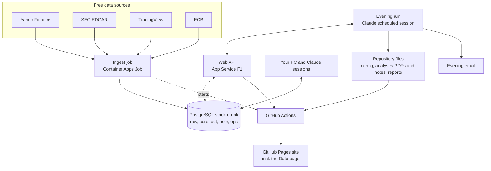

# Architecture

The project is a scheduled job that fills a database with free market data, and a few
Python scripts that read that database to screen and value companies and turn the results
into dated PDFs, a public web page and an evening email. Claude runs the scripts in Claude
Code sessions and writes the judgement (notes, verdicts, reports); the scripts produce the
numbers.

It is one repository and one Python package (`src/stock_analysis`), with its settings in
`config/`, run in five places. They meet in one PostgreSQL database
([`DATABASE.md`](DATABASE.md)). Since issue #33 the database is the only store of market
data: only the ingest job calls the sources, and the scripts read through
`stock_analysis.data` and `stock_analysis.stocks`.

The drawn version of this map, with the daily timeline, is [`pipeline.html`](pipeline.html)
(published at https://claude.ai/artifact/A54Gn496CWVif9xdr5fgCi). Keep it matching this page.
Its section "Inside the database, in UML" draws the data path in UML 2.5: an
activity diagram of the nightly run (ingest, build, coverage), an activity diagram of building
the fundamentals (standardise, fill, reconcile, derive), a class diagram of the tables and a
state machine of an ingest task.

| Piece | Runs on | Started by | Code |
|---|---|---|---|
| Ingest job | Azure Container Apps Job `stock-ingest` | A schedule (22:30 UTC daily) | `python -m stock_analysis.db ingest` ([`INGEST.md`](INGEST.md)) |
| Database | Azure Database for PostgreSQL `stock-db-bk` (and Docker locally) | Always on | `src/stock_analysis/db/` |
| Web API | Azure App Service `stock-api-bk` (F1) | An HTTPS request | `api/app.py` |
| Evening run | A scheduled Claude Code session | Weekdays 21:00 Italy time | `analysis/watchlist.py` ([`EVENING_RUN.md`](EVENING_RUN.md)) |
| Site | GitHub Actions + GitHub Pages | A push to `main`, the end of an ingest run, a daily schedule | `analysis/site.py` |
| Analyses by hand | Your PC or a Claude session | You | `analysis/absolute.py`, `peer_screen.py`, `screen.py`, `stock_analysis.stocks` |



## Layers

```
 1. DATA SOURCES (all free)
    Yahoo Finance       SEC EDGAR                TradingView             ECB
    prices, statements, company facts, full      screener fields, index  FX rates
    earnings dates      filings, bulk data sets  members, watch list
        |                   |                        |                     |
        v                   v                        v                     v
 2. INGEST (src/stock_analysis/ingest, nightly on Azure)
    raw_* tables, one row per fetch in raw_fetch, every payload kept (raw_payload)
    for the S&P 500, the watch list's stocks and peers, extra_symbols and the market
    report's instruments (config/market.toml)
        |
        v
 3. BUILD (src/stock_analysis/db/build.py, after each ingest)
    core_company, core_price_daily, core_market_daily, core_fundamental(_ttm),
    core_quality_issue; views v_annual, v_daily, v_earnings, v_tv_latest
        |
        v
 4. ANALYSES (read the database: stock_analysis.data, stock_analysis.stocks)
    absolute.py (step 1)  screen.py  peer_screen.py
    stage1.py -> stage2.py (run together by screener.py)
    watchlist.py (own-history P/E, entry price)   market.py   validate.py
        |
        v
 5. OUTPUTS AND DELIVERY
    database: out_screener_*, out_watchlist_run, out_market_run, out_note, user_watchlist
    analyses/<SYMBOL>/YYYY-MM-DD_HHMM.pdf, notes.md, README.md (dated list from the runs)
    reports/NN-*.md (written by Claude), docs/METRICS.md (generated)
    git push to main -> GitHub Actions (pages.yml) -> analysis/site.py -> GitHub Pages
    analysis/send_email.py -> Brevo API -> email to Babak (body + every PDF attached)
```

## Module map

### `src/stock_analysis/` (the installable package)

| File | Purpose |
|---|---|
| `stocks.py` | The analyses' view of a stock, from the database: `rows()` (absolute values in $bn, ratios, growth, standard DCF, analysts' target and rating; one row per stock), `history()` (every fiscal year, long format, with each value's source), `statements()`, `closes()`, `monthly_closes()`, `market_closes()`, `earnings()`, `splits()`, `fx_rates()`, `screener_run()`. Values a source other than SEC reports are converted to dollars at the ECB's newest rate. |
| `data.py` | One way for scripts and Claude to read and write the database (`Data.open()`): named reads, read-only SQL, saving notes, runs, valuations, screener runs and the watch list; directly on a PC, through the web API in cloud sessions. |
| `watchlist.py` | Loads `config/watchlist.toml` and mirrors it into the user tables (`sync`). |
| `tradingview.py` | Pages through TradingView's public screener endpoint, 2,000 rows a request; `SCREENER_FIELDS`, the fields the ingest keeps for the screener. |
| `ecb.py` | The address of the ECB's reference rates (the ingest fetches them). |
| `metrics.py` | The metrics dictionary: loads `config/metrics.toml`, selects sets, builds per-stock vectors, standardizes them, and writes `docs/METRICS.md`. |
| `db/` | The project database (`docs/DATABASE.md`), on PostgreSQL through SQLAlchemy and psycopg: `__init__.py` (targets from `config/database.toml`, `Database`, migrations: every number not applied yet runs, in order), `migrations/` (numbered SQL files), `raw.py` (raw-layer helpers: store only new or changed rows), `build.py` (rebuilds core from raw), `check.py` (read-only PASS/WARN/FAIL report), `azure.py` (`allow-my-ip`, and `JobFirewall` for an ingest run on Azure), `roles.py` (`create-roles`: `stock_reader`, `stock_writer`), `ping.py` (connection diagnosis), `tunnel.py` (PostgreSQL through an HTTP proxy), `coverage.py` (completeness and quality against `config/coverage.toml`, the daily snapshot); `python -m stock_analysis.db {init,build,status,check,ingest,import,reparse,push,coverage,tasks} [--target]`. |
| `ingest/` | The scheduled ingest job (`docs/INGEST.md`): `job.py` (the task queue, budgets, stops, the run log and lock; the watch list's symbols and the market instruments; earnings due again after a report), `sec.py`, `xbrl.py`, `files.py` (bulk files from `inbox/`), `push.py`, `yahoo.py` (prices, statements, earnings dates, through one client the tests replace), `market.py` (TradingView snapshots of the index and of the watch list, ECB rates), `common.py`, `notify.py` (starts the Pages workflow when a run ends). |

### `analysis/` (scripts, run with `uv run python analysis/<name>.py`)

Only the scripts the evening run and the site use are kept (issue #33).

| File | Purpose |
|---|---|
| `absolute.py` | Step 1 of every analysis: the absolute values from `config/absolute_values.toml` for the companies named, latest or by fiscal year (`--history`). The watch list's PDFs use its config helpers. |
| `screen.py` | The strict debt rules (`--strict`) and the weighted score (`--balanced`, debt 50%, profit and cash 25%, cheapness 25%) on a table of stocks. |
| `peer_screen.py` | The strict and weighted screens on a hand-picked peer group; the watch list's PDFs run it on each stock's peers. |
| `screen_common.py` | Settings loader and US-dollar columns shared by Stage 1 and Stage 2. |
| `stage1.py` | Screener Stage 1: the index members of the newest TradingView snapshot in the database, gaps filled from the core values, Lynch category, rules per category or business type. |
| `stage2.py` | Screener Stage 2: takes Stage 1's output, sets each survivor's cheap price (monthly closes, Yahoo's reported EPS from the database), ranks, adds technicals and the SEC cross-check (the SEC filings in the database). |
| `screener.py` | Runs Stage 1 then Stage 2 and saves the run in the database (`out_screener_run`, `out_screener_result`). `run()` is called by the evening run. |
| `watchlist.py` | The evening run's driver: mirrors the watch list and the notes into the database, runs the screener and the market report, then one PDF per watch-list stock and a summary PDF; records the runs (`out_watchlist_run`), rebuilds the dated lists, writes the email body. |
| `market.py` | The whole-market PDF: the instruments of `config/market.toml`, breadth of the index members, and the screener's top 3 per sector; records the run (`out_market_run`). |
| `site.py` | Builds the public GitHub Pages site from the PDFs and notes in `analyses/` and the database (runs, screener, coverage, explorer; standard library only). |
| `explore.py` | Exports the ticker explorer's data (issue #20) from the database: `tickers/<SYMBOL>.json` and `tickers/index.json` (standard library only; web API or `stock_analysis.data`). |
| `explorer.js` | The ticker page's script: draws the tabs and the SVG charts in the browser from that JSON. |
| `send_email.py` | Sends the last run's email through Brevo with every PDF attached. |
| `validate.py` | Checks the run's outputs (the screener run, the watch list's rows and history, the recorded runs, the PDFs, `last_run.json`) and prints PASS / WARN / FAIL. |

### `tests/`

`test_absolute.py` (configured columns exist in the rows), `test_metrics.py` (dictionary
complete, `docs/METRICS.md` up to date), `test_screener.py` (TradingView paging,
categories, rules, cheap price, ranking, the Stage 1 to Stage 2 contract),
`test_watchlist.py` (adjusted EPS, P/E history, notes, PDFs never overwritten, the site),
`test_pipeline_units.py` (missing values, splits, currencies, outliers and the SEC
cross-check, with a fake database), `test_data_validation.py` (`validate.py` on hand-built
outputs), `test_db.py` (the database: the build rules, trailing twelve months, the daily
as-of view, quality checks, the data interface and the API; seeded by `seed_files.py`),
`test_ingest.py` (the job, the sources, the watch list's symbols and the market
instruments), `test_explore.py`.

## Data flow, source by source

| Source | Fetched by (ingest) | Lands in | Read by |
|---|---|---|---|
| TradingView, index members and screener fields | `tradingview` | `raw_tv_constituent` (`v_tv_latest`), `core_company`, `core_index_member` | `stage1.py`; the rows' forward EPS, beta, analysts' target and rating |
| TradingView, the watch list's symbols outside the index | `tradingview_watchlist` | the same | the same |
| SEC company facts, full filings, data sets | `sec_companyfacts`, `sec_xbrl`, `db import` | `raw_sec_*` | `core_fundamental`, the rows, the history, Stage 2's SEC check |
| Yahoo statements | `yahoo_statements` | `raw_yahoo_statement` | `core_fundamental` (gaps SEC leaves) |
| Yahoo daily prices | `yahoo_prices` | `raw_yahoo_price` | `core_price_daily`: every price, P/E history, breadth |
| Yahoo prices of indices, ETFs, rates, commodities | `yahoo_market` | `raw_yahoo_price` | `core_market_daily`: the market report |
| Yahoo earnings dates | `yahoo_earnings` | `raw_yahoo_earnings` (`v_earnings`) | Adjusted EPS, own-history P/E, entry prices, Stage 2's adjusted cheap price |
| ECB reference rates | `ecb_rates` | `raw_ecb_rate` | Dollar conversions (`stocks.fx_rates`) |
| Claude's notes | (the evening run) | `analyses/*/notes.md`, `out_note` | PDFs, the site, the email |

## Where state lives

| Place | Committed | What it holds | Written by |
|---|---|---|---|
| `config/` | Yes | Settings: absolute values, watch list, screener rules, metrics dictionary, market instruments, ingest, coverage | People and Claude, by hand |
| Azure Database for PostgreSQL `stock-db-bk` | No | Everything: raw data, the cleaned core, the screener runs, the watch list's and market runs, notes, the job's queue and run log, the daily coverage snapshots | The ingest job, `build`, the evening run |
| Docker volume `stock-db` | No | The local PostgreSQL database (`compose.yaml`, target `local`) for development and tests | `db ingest`, `db import`, `build`, the tests |
| `inbox/` | No | Files downloaded by hand, waiting for `db import` | You |
| `.cache/watchlist/` | No | `email.html` and `last_run.json` of the last run | `watchlist.py` |
| `analyses/` | Yes | Dated PDFs, `notes.md`, the dated lists | `watchlist.py`, `market.py`, Claude (notes) |
| `reports/` | Yes | Numbered reports | Claude |
| `docs/` | Yes | This documentation; `METRICS.md` is generated | Claude; `stock_analysis.metrics doc` |
| `_site/` | No | The built web site | `site.py` (locally or in the Pages workflow) |
| Cloud environment settings | No (never in the repository) | `STOCK_API_URL`, `SEC_USER_AGENT`, `BREVO_API_KEY`, `WATCHLIST_EMAIL_FROM`, `WATCHLIST_EMAIL_TO` | Babak, in the environment's settings |
| Azure job secrets, GitHub repository secrets | No | The ingest job's database password, `SEC_USER_AGENT`, `GITHUB_DISPATCH_TOKEN`; `STOCK_API_KEY` for the Pages workflow | `deploy/ingest-job.ps1` from `.env`; Babak in GitHub's settings |

## Design principles

1. **Absolute values first.** Every analysis starts with price, market value, DCF fair value,
   debt (total, net, short-term, long-term), cash, revenue, EBITDA, net income, EPS,
   operating cash flow, capex and free cash flow, and their yearly history. Ratios, scores and
   rankings come after, never instead, because they hide information. The list is
   `config/absolute_values.toml`; the screener's tables also lead with absolute values.
2. **One way in for data.** Only the ingest job calls the sources; everything else reads the
   database. A value an analysis needs and the database lacks is added to the ingest.
3. **Two separate screener stages.** Stage 1 judges the financial statements and ignores the
   price. Stage 2 judges only the price, and only for Stage 1's survivors, and refuses to run
   if a column it needs is missing (`stage2.NEEDS`). Either can change without the other.
4. **Every run is kept.** Dated PDFs are never overwritten (`watchlist.new_pdf` adds `-2`,
   `-3` for a second run in the same minute), every run is a row of `out_watchlist_run`,
   and stocks dropped from the watch list keep their folder. It is a list of dated analyses.
5. **Free data sources.** Yahoo Finance, SEC EDGAR, TradingView's public screener and the
   ECB. No paid plan is needed.
6. **No secrets in the repository.** It is public. Keys and email addresses live in the cloud
   environment's settings and are read from environment variables; docs and code name only
   the variables.
7. **Tests never hit the network.** HTTP is mocked with `respx`; the database tests use a
   local PostgreSQL; everything else is tested on small hand-made frames.
8. **The code is the source of truth for numbers; Claude's notes are the source of truth
   for judgement.** PDFs combine both, and each states the dates of its numbers and of the
   notes.
