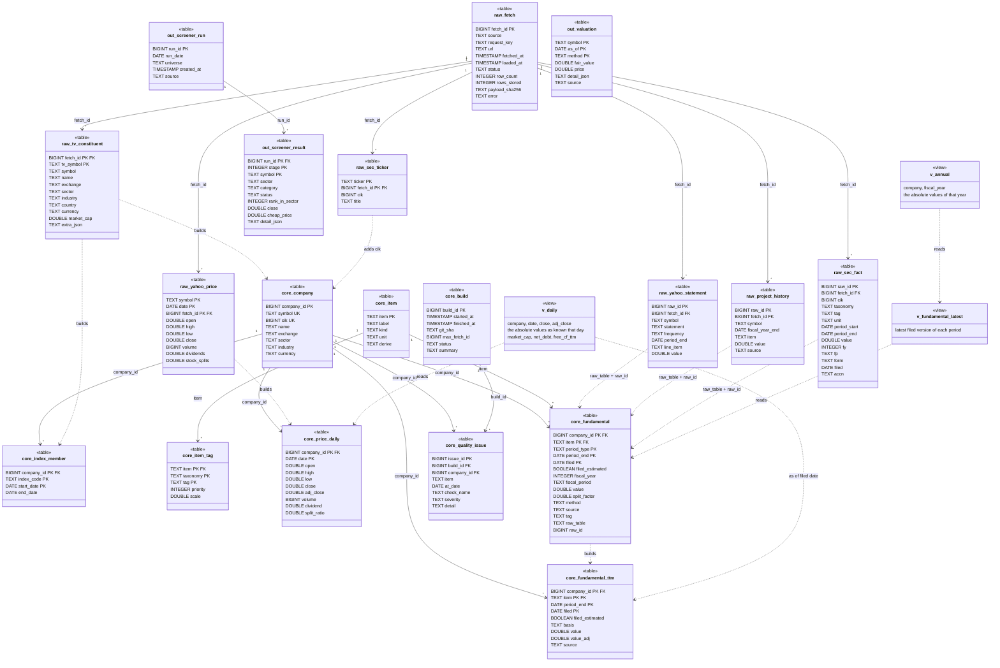

# Database

Status: **schema version 2** (migrations `001`, `002`), local SQLite, 2026-11-16. It holds the data
already in `data/`. No API has been called to fill it, and no analysis reads it yet. The
roadmap is [issue #16](https://github.com/khalilvandian/Stock-analysis/issues/16).

The design follows how the project analyses a company:
- the absolute values first, for every fiscal year and as of any day
- the screener's results, and valuations
- a clear record of where every number came from

Only what those need is stored.

## Use

```bash
uv run python -m stock_analysis.db init         # create data/stock.db, apply the migrations
uv run python -m stock_analysis.db load-files   # import the files in data/ (no network)
uv run python -m stock_analysis.db build        # rebuild the core layer from raw
uv run python -m stock_analysis.db status       # rows per table
uv run python -m stock_analysis.db check        # connection, schema and data (see below)
```

### Checking a database

`check` connects read-only to the selected target (or `--target server`) and prints PASS,
WARN or FAIL for each check. It exits 1 on any FAIL, and with `--strict` on any WARN too.
It works on SQLite and on PostgreSQL. PostgreSQL needs the optional driver:
`uv sync --extra server`.

| Check | FAIL when | WARN when |
|---|---|---|
| connection | the target has no URL, the file is missing, or the server can't be reached | none |
| tables and views | any table or view in the migrations is missing | none |
| schema version | the database is behind the code | the database is ahead of the code |
| last build | there is no build, or it failed | none |
| rows per table | a core or out table that should have rows is empty | `raw_sec_*` or `out_valuation` is empty |
| newest price, S&P 500 snapshot, screener run | none | older than `max_age_days` (7) |
| S&P 500 members with prices and with fundamentals | none | below `min_coverage` (95%) |
| each of `sample_symbols` (NEE, DUK, SO) | not a company, no prices, or no fiscal year with revenue | the latest day lacks revenue, debt or cash |
| prices are positive; filed on or after the period end | any row breaks the rule | none |
| quality issues | any of severity `error` | none |

The settings are under `[check]` in `config/database.toml`. These checks are separate from
`pytest`, which never touches the network. `tests/test_db.py` runs the same checks on a small
database it builds itself.

On the local file today: 26 pass, 5 warn, 0 fail. The warnings are:
- prices 52 days old
- 6 and 30 of 497 members with prices and with fundamentals
- no SEC data yet

Three views answer most questions:

```sql
SELECT * FROM v_annual WHERE symbol = 'NEE' ORDER BY fiscal_year;       -- absolute values per year
SELECT * FROM v_daily  WHERE symbol = 'NEE' AND date = '2026-09-25';     -- as known that day
SELECT * FROM out_screener_result WHERE stage = 2 ORDER BY sector, rank_in_sector;
```

- **Which database:** `config/database.toml` lists the targets and the `selected` one:
  - `local`: the SQLite file `data/stock.db`, built from `data/`
  - `server`: PostgreSQL, whose URL is empty until the server exists

  `--target NAME` or the `DATABASE_URL` environment variable overrides the selection.
  Passwords are never in the file: a target reads its password from the environment
  variable named in `password_env` (`STOCK_DB_PASSWORD`).
- **Not committed:** the database itself is never committed. `data/stock.db*` is
  gitignored, and the repository holds only the code and the migrations that build it.
- **Loading and building** run on SQLite for now.
- **Rerunning:** `load-files` can be run again safely, and only stores what is new or
  changed. `build` rewrites core each time.
- **Code:** `src/stock_analysis/db/`:
  - `migrations/`: numbered SQL files
  - `load_files.py`
  - `build.py`
- **Items:** `config/db_items.toml` lists the items and their source fields. Tests are in
  `tests/test_db.py`.

## Ready for PostgreSQL

- **Portable SQL:** the migrations use only SQL that both engines run:
  - `DATE`, `TIMESTAMP`, `BOOLEAN`, `DOUBLE PRECISION`, `BIGINT`
  - `ON CONFLICT`, window functions
- **Auto-numbered keys:** `{{ID}}` in a migration becomes `INTEGER PRIMARY KEY` on SQLite
  and `BIGINT GENERATED BY DEFAULT AS IDENTITY PRIMARY KEY` on PostgreSQL. A test checks
  that the PostgreSQL text has no SQLite-only parts.
- **Migrations:** `schema_version` records which migrations have been applied. A new
  change is a new numbered file, and existing ones are never edited. `connect` applies
  any new ones, so an older database upgrades in place (`002` adds open, high and low).
- **Still SQLite-only:** the connection code (`connect`) and `sqlite_master` in
  `table_counts`. The JSON columns are `TEXT`, and can become `jsonb` on the server.

## Layers

| Layer | Holds | Written by | Rule |
|---|---|---|---|
| `raw_*` | What each source returned, one table per source | The loaders (`load_files.py` now, API loaders later) | Append only. A row is stored when it is **new or its values changed** since the last version of the same key, and nothing is ever edited. Each row points to its `raw_fetch` |
| `core_*` | One cleaned, standard version: companies, index membership, daily prices, fundamentals with every filed version, trailing twelve months, quality issues | `build.py`, from raw and `config/db_items.toml` only | Rewritten on every build. `core_company` is updated in place so `company_id` stays the same |
| `out_*` | Results of the analyses: screener runs, valuations | The analyses (for now `load_files.py`, from their output files) | Keyed by **symbol and date**, so an analysis can write without a build |
| `v_*` | Views for analysis | none | `v_annual`, `v_daily`, `v_fundamental_latest` |

## UML class diagram

`<<table>>` is a stored table and `<<view>>` is a SQL view. Solid arrows are foreign keys,
one to many. Dotted arrows show where the build reads raw data, or where a view reads its
tables.



## What is in it now

From the repository files, 2026-11-16 (28 MB):

| Table | Rows | Contents |
|---|---|---|
| `raw_yahoo_price` | 46,769 | Daily open, high, low, close, volume, dividends and splits for NEE, DUK, SO, NRG, VST, CEG and TLN, all history to 2026-09-25 |
| `raw_yahoo_statement` | 11,145 | The Yahoo statements of the same 7 companies |
| `raw_tv_constituent` | 4,470 | The 9 TradingView S&P 500 snapshots, 2026-10-27 to 2026-11-13, with all 116 columns |
| `raw_project_history` | 12,562 | `data/sector/history.csv`: 102 utilities, fiscal years 2016–2025 |
| `raw_sec_fact`, `raw_sec_ticker` | 0 | Need the SEC API |
| `core_company`, `core_index_member` | 499, 499 | 497 current S&P 500 members and 2 that left. No CIKs yet |
| `core_price_daily` | 14,475 | The 6 S&P 500 companies with local prices, from 2016-01-04 |
| `core_fundamental` | 3,518 | 30 companies (17 items) |
| `core_fundamental_ttm` | 3,352 | Trailing figures |
| `core_quality_issue` | 122 | Last build |
| `out_screener_result` | 527 | The 2026-11-13 run: 497 from Stage 1, 30 from Stage 2 |
| `out_valuation` | 97 | DCF fair values from `utilities.csv` and the peer tables, 2026-09-28 to 2026-10-27 |

## Tables

### Raw

| Table | One row per | Notes |
|---|---|---|
| `raw_fetch` | Download or imported file | `source` is one of `tradingview`, `yahoo_prices`, `yahoo_statements`, `project_history`, `sec_tickers` or `sec_companyfacts`. `url` is `file:<path>` for a repository file. `row_count` is the rows received and `rows_stored` the rows that were new or changed. A file with the same SHA-256 as one loaded before is skipped |
| `raw_tv_constituent` | Company in one S&P 500 snapshot | The whole snapshot is stored, since its prices change daily. `extra_json` holds the columns that have no field of their own |
| `raw_yahoo_price` | Symbol, day and version | Open, high, low and close (split-adjusted), volume, dividends and splits. The dividend-adjusted close is **computed in core**, so a dividend does not rewrite the history here, and Yahoo's own adjusted close isn't stored. Open, high and low were added by migration `002` for technical analysis |
| `raw_yahoo_statement` | Line item, period and version | Yahoo's own names (`Total Revenue`) |
| `raw_project_history` | Value in `history.csv` and version | As in the file: money in $bn |
| `raw_sec_fact` | XBRL fact and version | Only the tags in `config/db_items.toml`. A tag added later is fetched again from SEC, which is free and takes a few minutes |

### Core

| Table | One row per | Notes |
|---|---|---|
| `core_company` | Company | By `company_id`. `symbol` comes from TradingView, and `cik` is filled once the SEC ticker file is loaded |
| `core_index_member` | Run of consecutive snapshots a company was in | An empty `end_date` means it is still a member. Membership history only starts at the first snapshot (2026-10-27) |
| `core_item`, `core_item_tag` | Item, and item plus source field | From the config, on every build |
| `core_price_daily` | Company and trading day, from 2016-01-01 | `adj_close` = close × the product of (1 − dividend ÷ prior close) over later ex-dates. That is Yahoo's method, and on the local data it matches Yahoo's figure to within 1e-6 |
| `core_fundamental` | Company, item, period and **filing date** | Every version is kept. `period_type` is `Q`, `FY` or `I` (instant). `method` is `reported` or `derived`. `raw_table` and `raw_id` name the raw row |
| `core_fundamental_ttm` | Company, item, period end and filing date | Trailing twelve months **for each version**, so a restated quarter gives a second value from the day it was filed. `value_adj` is on today's share basis |
| `core_quality_issue` | Problem found by a build | Kept for every build |
| `core_build` | Build | Raw data used, git commit, row counts or the error |

### Out

| Table | One row per | Notes |
|---|---|---|
| `out_screener_run` | Screener run (date and universe) | Today only the latest run exists as files. Every evening run will add one |
| `out_screener_result` | Symbol in Stage 1 or Stage 2 of a run | The fields the site and email show (sector, category, status, rank, close, cheap price). Every other column goes in `detail_json` |
| `out_valuation` | Symbol, date and method | Fair value per share, the price, and the inputs (WACC, cash flow) in `detail_json` |

### Views

| View | One row per | Gives |
|---|---|---|
| `v_annual` | Company and fiscal year | The absolute values in their latest filed version: revenue, EBITDA, net income, EPS, operating cash flow, capex, free cash flow, interest, cash, the three debts, net debt, assets, liabilities, equity and shares. Shares and EPS are on today's basis. This is what `absolute.py --history` shows |
| `v_daily` | Company and trading day | The close, the adjusted close and the absolute values as known that day. Flows are trailing twelve months (`_ttm`). Also `market_cap`, `net_debt` and `free_cf_ttm` |
| `v_fundamental_latest` | Company, item and period | The latest filed version |

## The 17 items

The full field lists are in `config/db_items.toml`.

| Item | Kind | Derived as | Yahoo (first field) | history.csv |
|---|---|---|---|---|
| `revenue` | flow | none | Total Revenue | revenue |
| `operating_income` | flow | none | Operating Income | none |
| `d_and_a` | flow | none | Reconciled Depreciation | none |
| `ebitda` | flow | operating_income + d_and_a (as `analysis/history.py`) | EBITDA (fallback) | ebitda |
| `net_income` | flow | none | Net Income | net_income |
| `eps_diluted` | flow | none | Diluted EPS | eps |
| `interest_expense` | flow | none | Interest Expense | none |
| `operating_cf` | flow | none | Operating Cash Flow | operating_cf |
| `capex` | flow, negative | none | Capital Expenditure | capex |
| `cash` | instant | none | Cash And Cash Equivalents | cash |
| `short_term_debt` | instant | none | Current Debt | short_term_debt |
| `long_term_debt` | instant | none | Long Term Debt | long_term_debt |
| `total_debt` | instant | short_term_debt + long_term_debt | Total Debt (fallback) | total_debt |
| `total_assets` | instant | none | Total Assets | none |
| `total_liabilities` | instant | none | Total Liabilities Net Minority Interest | none |
| `equity` | instant | none | Stockholders Equity | none |
| `shares_outstanding` | instant | none | Ordinary Shares Number | none |

Free cash flow, net debt and market value are calculated in the views, not stored.

## Build rules

1. **Companies:** core covers companies in the TradingView S&P 500 snapshots. Raw keeps
   everything else too, such as TLN and the non-S&P 500 utilities.
2. **One source per period:** for each company, item, period type and period end, the build
   takes the best source (SEC, then `history.csv`, then Yahoo), then the first field in the
   config order. It keeps every filing date (version) of that source.
3. **Derived items:** a derived item (`ebitda`, `total_debt`) is computed wherever all its
   parts exist. It replaces a reported value from the same or a lower-ranked source, never
   one from a better source. For example, `history.csv`'s SEC EBITDA is not overridden by
   Yahoo's operating income + D&A.
4. **Periods:** the fiscal quarter is counted from the company's fiscal year-end month, with
   52/53-week ends rounded to the nearest month end. Balance-sheet items are `I` whatever
   file they came from.
5. **Filing dates:** no source loaded so far records filing dates. They are estimated as
   the period end plus the latest SEC deadline (90 days after a year, 45 after a quarter)
   and marked `filed_estimated`. The view can show a figure late but never early. SEC
   facts will bring real dates.
6. **Splits:** Yahoo shares and EPS are adjusted for the splits after their filing date.
   `history.csv` is meant to be adjusted already (see the caveat below).
7. **Trailing twelve months:** at a fiscal year end, the fiscal-year value. Otherwise, the
   sum of four consecutive quarters (ends 250–300 days apart), using each quarter's
   latest version as of each filing date.
8. **Checks** (`core_quality_issue`, last build):

| Check | Count | Meaning |
|---|---|---|
| `jump_10x` | 50 | A value moved more than 10× from one period to the next |
| `sources_disagree` | 48 | `history.csv` and Yahoo differ by more than 2% for the same period |
| `balance_sheet_identity` | 13 | Assets − liabilities − equity is more than 2% of assets (minority interest at NEE and SO) |
| `implied_shares_jump` | 6 | Net income ÷ EPS moved 1.8× or more in a year, usually a split not applied to EPS |
| `missing_period` | 5 | A quarter or year is missing |
| `short_trading_year` | 0 | Fewer than 200 trading days in a full year |

**Caveat found by these checks:** `history.csv` has EPS and market value that were never
split-adjusted. NEE's EPS for 2016–2017 is in pre-2020-split shares (6.24 and 11.39 against
3.47 in 2018), and so is its 2016–2017 market value. ETR and SRE look the same. The cause is
in `analysis/history.py`'s `split_adjust`, not in the database. The database stores the file
as it is and flags it.

## Not done yet

- **API loaders:**
  - TradingView daily
  - the SEC ticker file (gives the CIKs)
  - SEC company facts (10 years, real filing dates)
  - Yahoo prices for the whole S&P 500 from 2016, fetching only new days
- **Analyses writing to `out_*`:** the evening run and the screener writing their results
  to the database.
- **Readers:** no analysis, dashboard or the site reads the database yet.
- **Server:** PostgreSQL, run with the same migration.
- **Older index membership:** S&P 500 membership before 2026-10-27, needed before any
  backtest.
