# Database

Status: **schema version 15** (migrations `001` to `015`; `011` and `012` are left to issue #30), 2026-11-19. **PostgreSQL 16**,
locally in Docker (`compose.yaml`) and on the server: **Azure Database for PostgreSQL**
(`stock-db-bk`, Italy North, Azure for Students). SQLite was dropped on 2026-11-16 (see
`docs/DECISIONS.md`). It holds what the ingest job fetches from TradingView, SEC, Yahoo and
the ECB ([`INGEST.md`](INGEST.md), [issue #18](https://github.com/khalilvandian/Stock-analysis/issues/18)),
the watch list, and every result of the analyses. How complete it is:
[`COVERAGE.md`](COVERAGE.md) and the site's Data page. Since
[issue #33](https://github.com/khalilvandian/Stock-analysis/issues/33) it is the only store of
market data: every analysis script reads it (`stock_analysis.data`, `stock_analysis.stocks`)
and the files under `data/` are gone. The first roadmap was
[issue #16](https://github.com/khalilvandian/Stock-analysis/issues/16).

The design follows how the project analyses a company:
- the absolute values first, for every fiscal year and as of any day
- the prices for technical analysis
- the screener's results, valuations, and the watch list with its evening runs
- a clear record of where every number came from

Only what those need is stored.

## Use

```bash
# once: put STOCK_DB_PASSWORD=<a long random value> in .env (see .env.example)
docker compose up -d --wait                     # PostgreSQL 16 on 127.0.0.1:5432, healthy
uv run python -m stock_analysis.db init         # create the tables (apply the migrations)
uv run python -m stock_analysis.db build        # build core for what is new (--symbols A,B)
uv run python -m stock_analysis.db check-sample --symbols A,B  # what a rebuild would change; writes nothing
uv run python -m stock_analysis.db status       # rows per table
uv run python -m stock_analysis.db check        # connection, schema and data (see below)
uv run python -m stock_analysis.db ingest       # fetch from the sources (docs/INGEST.md)
uv run python -m stock_analysis.db coverage     # how complete it is (docs/COVERAGE.md)
```

Every command takes `--target local | server`. Without it, the `selected` target in
`config/database.toml` (`local`) is used, or `DATABASE_URL` if that is set.

Four queries answer most questions:

```sql
SELECT * FROM v_annual WHERE symbol = 'NEE' ORDER BY fiscal_year;       -- absolute values per year
SELECT * FROM v_daily  WHERE symbol = 'NEE' AND date = '2026-09-25';     -- as known that day
SELECT * FROM out_screener_result WHERE stage = 2 ORDER BY sector, rank_in_sector;
SELECT * FROM v_watchlist ORDER BY position;                              -- watch list, last run
```

- **Targets** (`config/database.toml`):

  | Target | What it is | Password |
  |---|---|---|
  | `local` | PostgreSQL 16 in Docker on this machine (`compose.yaml`), at `127.0.0.1:5432`, database `stock` | `STOCK_DB_PASSWORD` |
  | `server` | Azure Database for PostgreSQL, `stock-db-bk.postgres.database.azure.com`, database `stock`, user `stock_admin`, TLS required (see "The server") | `STOCK_SERVER_DB_PASSWORD` |

  Passwords are never in the config. A target reads its password from the environment
  variable named in `password_env`, and `.env` (gitignored) is read automatically.
- **Docker:** `compose.yaml` runs only the database. It uses the official `postgres:16`
  image, binds the port to `127.0.0.1` so only this machine can connect, keeps the data in
  the `stock-db` volume, and has a health check. Our migrations create the tables, not the
  container. `docker compose down` stops it and keeps the data; `down -v` deletes the data.
- **Not committed:** the database is never committed. The data lives in the Docker volume,
  and the repository holds only the code and the migrations that build it.
- **Rerunning:** the ingest stores only what is new or changed. `build` builds core in one transaction, only for the companies with something
  new since the last build: raw rows stored after its `max_fetch_id`, a changed entry in
  `config/companies.toml`, a new company or a changed CIK. The other companies' core rows
  and quality issues stay as they are: the job adds what is new and never rebuilds the
  whole database. A change of the extraction (`config/db_items.toml`, `build.py`) is checked
  on a sample, not by rebuilding everything: `check-sample --symbols A,B` builds those
  companies with today's code, lists every value that would be added, removed or changed
  against the database, and rolls back (nothing is written); if the sample is right,
  `build --symbols A,B` writes it. Items newly added to `config/db_items.toml` are added to
  `core_item` without touching existing rows. `build --full` (every company) only when asked,
  or by itself on an empty core. Each step works company by company, so a company's rows
  are the same whichever way it was built
  (`test_incremental_build_rebuilds_only_what_changed_and_matches_a_full_one`). The summary
  records the mode, the reason, the companies built and the seconds per step. Rows are
  written with `COPY`.
- **Migrations:** `migrate` applies every number not yet in `schema_version`, in order, so
  a migration from another branch with a lower number than one already applied still runs.
  On the server, apply a new migration as the owner before the job's next run:
  `db init --target server`, then `db create-roles --target server` so the readers and the
  writer get the new tables. The job connects as `stock_writer`, which can't change the
  schema, so a migration left to the job fails its run ("permission denied for schema public").
- **Code:** `src/stock_analysis/db/`, through SQLAlchemy and psycopg:
  - `__init__.py`: targets, the `Database` class, migrations, helpers
  - `migrations/`: numbered SQL files
  - `raw.py`: the raw-layer helpers the loaders share
  - `build.py`
  - `check.py`
- **Items:** `config/db_items.toml` lists the items and their source fields.
- **Tests:** `tests/test_db.py` runs on the `stock_test` database in the same container, or
  on `STOCK_TEST_PG_URL`. Every test empties that database first, so never point it at
  `stock`; two sessions testing at once need a database each. The tests seed it with
  `tests/seed_files.py` (small files in the old `data/` layout). Without a reachable PostgreSQL the database tests are skipped, and the rest of
  the suite still runs. To create the test database once:
  `docker compose exec db psql -U stock -c "CREATE DATABASE stock_test"`.

## Users and how everything connects

There is **no API for now**: scripts and Claude connect **straight to the database** (decision of
2026-11-16 in `docs/DECISIONS.md`).

| User | Rights | Used by | Password |
|---|---|---|---|
| `stock_admin` (Azure) / `stock` (local) | Owner: migrations, `create-roles` | Your PC only | `STOCK_SERVER_DB_PASSWORD` / `STOCK_DB_PASSWORD` |
| `stock_writer` | Read, add and change data, rebuild core. Can't change the schema or `schema_version`, can't delete or change raw data (append only, except `raw_fetch` row counts) | The ingest, `build`, the evening run's results, Claude when it writes | `STOCK_WRITER_DB_PASSWORD` |
| `stock_reader` | Read only | Analyses, viewers, Claude when it reads | `STOCK_READER_DB_PASSWORD` |

`python -m stock_analysis.db create-roles --target server` (as the owner) creates both users or
updates their passwords and rights; missing passwords are generated into `.env` first.

Targets: `server-reader` and `server-writer` (and `local-reader`, `local-writer`) in
`config/database.toml`. `STOCK_DB_TARGET` sets the default target on a machine without editing
the config (e.g. `server-writer` in Claude's cloud environment).

**Reading and writing from Python** (`stock_analysis.data`, reads as `stock_reader`, writes as
`stock_writer`):

```python
from stock_analysis.data import Data

data = Data.open()  # server-reader / server-writer by default
data.watchlist()
data.annual("NEE")
data.daily("NEE", start="2025-01-01")
data.prices("NEE")
data.screener(stage=2)
data.notes("NFLX")
data.quality()
data.sql("SELECT symbol, revenue FROM v_annual WHERE fiscal_year = 2025")  # read-only, 50,000 rows
data.save_note("NFLX", "...")
data.save_watchlist_run({...})
data.set_watchlist([...])
```

`data.sql()` accepts one SELECT or WITH statement and runs it in a read-only transaction with a
20-second limit.

**Diagnosing a connection** from a new place:

```bash
uv run python -m stock_analysis.db ping --target server-reader
```

It prints this machine's public IP and proxy settings, then DNS, a plain TCP connection to port
5432, and a real login that shows the address the database sees. A `no pg_hba.conf entry for host
"x.x.x.x"` answer means the Azure firewall needs that address.

### Claude's cloud sessions: through the web API

Cloud sessions reach the internet only through Anthropic's HTTP proxy. Tested 2026-11-16: a
direct connection to port 5432 is refused, and although the proxy answers a CONNECT to port 5432
(or 22) with "200", nothing but web traffic reaches the far end. So cloud sessions use the web
API below. `db/tunnel.py` (PostgreSQL through an HTTP proxy's CONNECT tunnel, automatic when
`HTTPS_PROXY` applies; `STOCK_DB_PROXY=off` turns it off) stays for proxies that do pass it,
such as some company networks; it doesn't help on Anthropic's cloud.

## The web API (for cloud sessions)

Claude's cloud sessions can't reach PostgreSQL (their proxy only carries web traffic; tested
2026-11-16), so a small, general API runs on Azure next to the database: `api/app.py`
(FastAPI), deployed to the App Service `stock-api-bk` (Linux, free F1 plan `stock-api-plan`,
Italy North, HTTPS only) at https://stock-api-bk.azurewebsites.net. It has no route per
question: it runs SQL, and the database users' rights decide what is allowed.

| Route | Runs as | Does |
|---|---|---|
| `GET /health` | | `{"ok": true}`, no key needed |
| `GET /quotes` | `stock_reader` | No key: the newest quote of every company from `v_quote_latest` (issue #35), for the explorer pages. One fixed query (no input reaches SQL), quotes of the last 10 days only, cached 5 minutes in the app and in browsers, gzip, CORS open to `QUOTES_ORIGINS` (default `https://khalilvandian.github.io`). Answer `{"fetched_at", "columns": ["price", "change_pct", "session", "price_at", "delay_s", "currency"], "quotes": {SYMBOL: [...]}}`; `analysis/live.js` reads the columns by name, shows the delay ("15 min delayed") from `delay_s` and applies a quote only in the page's currency |
| `POST /query` `{"sql", "params", "limit"}` | `stock_reader` | One SELECT or WITH statement in a read-only transaction, 30 s limit, at most 50,000 rows. Answer `{"columns", "rows", "truncated"}` |
| `POST /execute` `{"steps": [{"sql", "rows"}]}` | `stock_writer` | INSERT, UPDATE, DELETE (or WITH, MERGE) steps in one transaction, all or nothing; each step runs once per row. Answer `{"rowcounts"}` |

Parameters are `:name` placeholders. Every route but `/health` and `/quotes` needs `X-API-Key:
<STOCK_API_KEY>`. App settings: `DATABASE_URL` (stock_reader), `DATABASE_WRITER_URL`
(stock_writer), `STOCK_API_KEY`. The database firewall allows the app's outbound addresses
(rules `stock-api`, `stock-api-2`). Protection, in layers: the key; HTTPS; one statement per
query or step; a read-only transaction for `/query`; and the users' rights (the writer can't
change the schema or `schema_version`, or change or delete raw data).

**From Python** nothing changes: `Data.open()` uses the API when `STOCK_API_URL` is set
(`stock_analysis.data.ApiData`; `data.query(sql, params)` and `data.execute([(sql, rows)])` for
anything the named reads and saves don't cover). In a cloud environment set
`STOCK_API_URL=https://stock-api-bk.azurewebsites.net` as an environment variable and the key as
a **network secret** (host `stock-api-bk.azurewebsites.net`, header `X-API-Key`, no prefix), so
the key never enters the session. On a PC, `STOCK_API_KEY` in `.env` does the same.

Redeploy after a change: zip `api/app.py` and `api/requirements.txt`, then
`az webapp deploy --name stock-api-bk --resource-group stock-rg --src-path api.zip --type zip`.

## The server (Azure)

| | |
|---|---|
| Service | Azure Database for PostgreSQL – Flexible Server, PostgreSQL 16 |
| Name, region | `stock-db-bk`, Italy North (Milan), resource group `stock-rg` |
| Subscription | **Azure for Students** (university account): no credit card, about $90–100 of credit a year while a student |
| Size | Burstable **Standard_B1ms** (1 vCore, 2 GiB), **32 GiB** Premium SSD, P4, storage autogrow **off** |
| Cost | **€0** within the free services for 12 months (750 hours of B1ms and 32 GB of storage and backups a month). The portal's estimate shows the list price ($18.91 a month) with both lines marked free. After 12 months it would use the student credit, which needs a decision then |
| Backups | Azure's automatic backups, 7 days, locally redundant (no geo-redundancy) |
| High availability | Off |
| Login | PostgreSQL authentication, admin `stock_admin`. The password lives only in the password manager and in `.env` as `STOCK_SERVER_DB_PASSWORD`, never in the repository |
| Network | Public access limited by **firewall rules**: only listed IP addresses can connect. *Allow Azure services* is off. TLS is enforced |

**Your IP changes** (home connections get a new public IP now and then). Then `check
--target server` times out and prints the fix:

```bash
uv run python -m stock_analysis.db allow-my-ip     # sets the firewall rule `home` to your current IP
uv run python -m stock_analysis.db allow-my-ip --rule NAME --ip 203.0.113.0/24   # another address or range
```

It uses the **Azure CLI** (`winget install Microsoft.AzureCLI`, then `az login` once with the
university account; in this setup `az login --use-device-code` worked best) and reads
`azure_server` and `azure_resource_group` from the `server` target in `config/database.toml`.
Each place you work from (home, university) needs its own rule, or a rerun of the command.
Some networks block outgoing port 5432.

**Filling it:** the same commands as locally, with `--target server`. On 2026-11-16 it was
filled from `data/` (import 15 s, build 6 s from Milan), `check` gave 28 pass, 6 warn, 0 fail,
and every row of `v_annual`, `v_daily`, `core_fundamental`, `core_fundamental_ttm`,
`core_company`, `out_screener_result`, `v_watchlist`, `out_watchlist_run`,
`user_watchlist_peer` and `out_valuation` was identical to the local database.

**Still to come:** the weekly worker (a small VM or GitHub Actions) and, with it, connecting
through that machine only, so no home IP needs to be in the firewall.

### Checking a database

`check` connects read-only to a target and prints PASS, WARN or FAIL for each check. It
exits 1 on any FAIL, and with `--strict` on any WARN too.

| Check | FAIL when | WARN when |
|---|---|---|
| connection | the target has no URL, or the server can't be reached (on a timeout to Azure it prints the `allow-my-ip` command) | none |
| tables and views | any table or view in the migrations is missing | none |
| schema version | the database is behind the code | the database is ahead of the code |
| last build | there is no build, or it failed | none |
| rows per table | a core, user or out table that should have rows is empty | `raw_sec_*` or `out_valuation` is empty |
| newest price, S&P 500 snapshot, screener run | none | older than `max_age_days` (7) |
| S&P 500 members with prices and with fundamentals | none | below `min_coverage` (95%) |
| watch list | none | a stock has no evening run, or no prices in core |
| each of `sample_symbols` (NEE, DUK, SO) | not a company, no prices, or no fiscal year with revenue | the latest day lacks revenue, debt or cash |
| prices are positive; filed on or after the period end | any row breaks the rule | none |
| quality issues | any of severity `error` | none |

The settings are under `[check]` in `config/database.toml`.

Today, on `local` and `server`: 28 pass, 6 warn, 0 fail. The warnings are:
- prices 52 days old
- 6 and 30 of 497 members with prices and with fundamentals
- no SEC data yet
- the 5 watch list stocks have no prices in core, because there are no local price files
  for them

## SQL conventions

- **Types:** `DATE`, `TIMESTAMP` (UTC), `BOOLEAN`, `DOUBLE PRECISION`, `BIGINT`, `TEXT`.
- **Keys:** auto-numbered keys are `BIGINT GENERATED BY DEFAULT AS IDENTITY PRIMARY KEY`.
- **Migrations:** `schema_version` records which migrations have been applied. A new
  change is a new numbered file, and existing ones are never edited. Opening a database
  applies any new ones, so an older database upgrades in place (`002` adds open, high and
  low; `003` adds the watch list).
- **Dates in Python:** reads return dates as `YYYY-MM-DD` text and timestamps as ISO text
  (`frame()` in `__init__.py`).
- **JSON:** the JSON columns are `TEXT`, and can become `jsonb` later.

## Layers

| Layer | Holds | Written by | Rule |
|---|---|---|---|
| `raw_*` | What each source returned: the payload itself as it came (`raw_payload`), and its parsed rows, one table per source | The ingest job (`ingest/*.py`; `raw_project_history` was loaded once from the retired `history.csv`) | Append only. A row is stored when it is **new or its values changed** since the last version of the same key, and nothing is ever edited. Each row points to its `raw_fetch`. Parsing can be redone from the kept payloads, so a parsing rule is never a reason to ask a source again |
| `core_*` | One cleaned, standard version: companies, index membership, daily prices, fundamentals with every filed version, trailing twelve months, quality issues | `build.py`, from raw, `config/db_items.toml` and `config/companies.toml` (predecessor CIKs) only | Rewritten on every build. `core_company` is updated in place so `company_id` stays the same |
| `user_*` | What people decide: the watch list (stocks, peers, target P/E, equity stakes, EPS corrections) | The evening run mirrors `config/watchlist.toml`, the master copy (`stock_analysis.watchlist.sync`); the ingest reads the stocks and peers from here | Keyed by symbol. A changed TOML replaces the mirror, and an unchanged one changes nothing |
| `out_*` | Results of the analyses: screener runs, valuations, the watch list's and the market report's evening runs, Claude's notes | The analyses (`screener.py`, `watchlist.py`, `market.py`) through `Data` | Keyed by **symbol and date**, so an analysis can write without a build |
| `v_*` | Views for analysis | none | `v_annual`, `v_daily`, `v_watchlist`, `v_fundamental_latest` |

## UML class diagram

`<<table>>` is a stored table and `<<view>>` is a SQL view. Solid arrows are foreign keys,
one to many. Dotted arrows show where the build reads raw data, or where a view reads its
tables.

```mermaid
classDiagram
  class raw_fetch {
    <<table>>
    BIGINT fetch_id PK
    TEXT source
    TEXT request_key
    TEXT url
    TIMESTAMP fetched_at
    TIMESTAMP loaded_at
    TEXT status
    INTEGER row_count
    INTEGER rows_stored
    TEXT payload_sha256
    TEXT error
  }
  class raw_tv_constituent {
    <<table>>
    BIGINT fetch_id PK FK
    TEXT tv_symbol PK
    TEXT symbol
    TEXT name
    TEXT exchange
    TEXT sector
    TEXT industry
    TEXT country
    TEXT currency
    DOUBLE market_cap
    TEXT extra_json
  }
  class raw_sec_ticker {
    <<table>>
    TEXT ticker PK
    BIGINT fetch_id PK FK
    BIGINT cik
    TEXT title
  }
  class raw_yahoo_price {
    <<table>>
    TEXT symbol PK
    DATE date PK
    BIGINT fetch_id PK FK
    DOUBLE open
    DOUBLE high
    DOUBLE low
    DOUBLE close
    BIGINT volume
    DOUBLE dividends
    DOUBLE stock_splits
  }
  class raw_yahoo_statement {
    <<table>>
    BIGINT raw_id PK
    BIGINT fetch_id FK
    TEXT symbol
    TEXT statement
    TEXT frequency
    DATE period_end
    TEXT line_item
    DOUBLE value
  }
  class raw_project_history {
    <<table>>
    BIGINT raw_id PK
    BIGINT fetch_id FK
    TEXT symbol
    DATE fiscal_year_end
    TEXT item
    DOUBLE value
    TEXT source
  }
  class raw_sec_fact {
    <<table>>
    BIGINT raw_id PK
    BIGINT fetch_id FK
    BIGINT cik
    TEXT taxonomy
    TEXT tag
    TEXT unit
    DATE period_start
    DATE period_end
    DOUBLE value
    INTEGER fy
    TEXT fp
    TEXT form
    DATE filed
    TEXT accn
  }
  class core_build {
    <<table>>
    BIGINT build_id PK
    TIMESTAMP started_at
    TIMESTAMP finished_at
    TEXT git_sha
    BIGINT max_fetch_id
    TEXT status
    TEXT summary
  }
  class core_company {
    <<table>>
    BIGINT company_id PK
    TEXT symbol UK
    BIGINT cik
    TEXT name
    TEXT exchange
    TEXT sector
    TEXT industry
    TEXT currency
  }
  class core_index_member {
    <<table>>
    BIGINT company_id PK FK
    TEXT index_code PK
    DATE start_date PK
    DATE end_date
  }
  class core_item {
    <<table>>
    TEXT item PK
    TEXT label
    TEXT kind
    TEXT unit
    TEXT derive
  }
  class core_item_tag {
    <<table>>
    TEXT item PK FK
    TEXT taxonomy PK
    TEXT tag PK
    INTEGER priority
    DOUBLE scale
  }
  class core_price_daily {
    <<table>>
    BIGINT company_id PK FK
    DATE date PK
    DOUBLE open
    DOUBLE high
    DOUBLE low
    DOUBLE close
    DOUBLE adj_close
    BIGINT volume
    DOUBLE dividend
    DOUBLE split_ratio
  }
  class core_fundamental {
    <<table>>
    BIGINT company_id PK FK
    TEXT item PK FK
    TEXT period_type PK
    DATE period_end PK
    DATE filed PK
    BOOLEAN filed_estimated
    INTEGER fiscal_year
    TEXT fiscal_period
    DOUBLE value
    DOUBLE split_factor
    TEXT method
    TEXT source
    TEXT tag
    TEXT raw_table
    BIGINT raw_id
  }
  class core_fundamental_ttm {
    <<table>>
    BIGINT company_id PK FK
    TEXT item PK FK
    DATE period_end PK
    DATE filed PK
    BOOLEAN filed_estimated
    TEXT basis
    DOUBLE value
    DOUBLE value_adj
    TEXT source
  }
  class core_quality_issue {
    <<table>>
    BIGINT issue_id PK
    BIGINT build_id FK
    BIGINT company_id FK
    TEXT item
    DATE at_date
    TEXT check_name
    TEXT severity
    TEXT detail
  }
  class out_screener_run {
    <<table>>
    BIGINT run_id PK
    DATE run_date
    TEXT universe
    TIMESTAMP created_at
    TEXT source
  }
  class out_screener_result {
    <<table>>
    BIGINT run_id PK FK
    INTEGER stage PK
    TEXT symbol PK
    TEXT sector
    TEXT category
    TEXT status
    INTEGER rank_in_sector
    DOUBLE close
    DOUBLE cheap_price
    TEXT detail_json
  }
  class out_valuation {
    <<table>>
    TEXT symbol PK
    DATE as_of PK
    TEXT method PK
    DOUBLE fair_value
    DOUBLE price
    TEXT detail_json
    TEXT source
  }
  class user_watchlist {
    <<table>>
    TEXT symbol PK
    INTEGER position
    DOUBLE target_pe
    TEXT target_note
    DOUBLE stakes_per_share
  }
  class user_watchlist_peer {
    <<table>>
    TEXT symbol PK FK
    TEXT peer PK
    INTEGER position
  }
  class user_eps_override {
    <<table>>
    TEXT symbol PK FK
    DATE reported PK
    DOUBLE eps
    TEXT reason
  }
  class out_watchlist_run {
    <<table>>
    TEXT symbol PK
    TIMESTAMP run_at PK
    TEXT file
    DOUBLE price
    DOUBLE eps_adj_ttm
    DOUBLE pe_adj
    DOUBLE pe_median_10y
    DOUBLE target_pe
    DOUBLE entry_price
    DOUBLE to_entry
    TEXT verdict
    DOUBLE stakes_per_share
  }
  class v_watchlist {
    <<view>>
    each watch list stock with its latest run
  }
  class v_fundamental_latest {
    <<view>>
    latest filed version of each period
  }
  class v_annual {
    <<view>>
    company, fiscal_year
    the absolute values of that year
  }
  class v_daily {
    <<view>>
    company, date, close, adj_close
    the absolute values as known that day
    market_cap, net_debt, free_cf_ttm
  }

  raw_fetch "1" --> "*" raw_tv_constituent : fetch_id
  raw_fetch "1" --> "*" raw_sec_ticker : fetch_id
  raw_fetch "1" --> "*" raw_yahoo_price : fetch_id
  raw_fetch "1" --> "*" raw_yahoo_statement : fetch_id
  raw_fetch "1" --> "*" raw_project_history : fetch_id
  raw_fetch "1" --> "*" raw_sec_fact : fetch_id
  core_company "1" --> "*" core_index_member : company_id
  core_company "1" --> "*" core_price_daily : company_id
  core_company "1" --> "*" core_fundamental : company_id
  core_company "1" --> "*" core_fundamental_ttm : company_id
  core_company "1" --> "*" core_quality_issue : company_id
  core_item "1" --> "*" core_item_tag : item
  core_item "1" --> "*" core_fundamental : item
  core_build "1" --> "*" core_quality_issue : build_id
  out_screener_run "1" --> "*" out_screener_result : run_id
  user_watchlist "1" --> "*" user_watchlist_peer : symbol
  user_watchlist "1" --> "*" user_eps_override : symbol
  v_watchlist ..> user_watchlist : reads
  v_watchlist ..> out_watchlist_run : latest run
  raw_tv_constituent ..> core_company : builds
  raw_tv_constituent ..> core_index_member : builds
  raw_sec_ticker ..> core_company : adds cik
  raw_yahoo_price ..> core_price_daily : builds
  raw_yahoo_statement ..> core_fundamental : raw_table + raw_id
  raw_project_history ..> core_fundamental : raw_table + raw_id
  raw_sec_fact ..> core_fundamental : raw_table + raw_id
  core_fundamental ..> core_fundamental_ttm : builds
  v_fundamental_latest ..> core_fundamental : reads
  v_annual ..> v_fundamental_latest : reads
  v_daily ..> core_price_daily : reads
  v_daily ..> core_fundamental_ttm : as of filed date
```



## What is in it now

From the repository files, 2026-11-16 (28 MB):

| Table | Rows | Contents |
|---|---|---|
| `raw_yahoo_price` | 46,769 | Daily open, high, low, close, volume, dividends and splits for NEE, DUK, SO, NRG, VST, CEG and TLN, all history to 2026-09-25 |
| `raw_yahoo_statement` | 11,145 | The Yahoo statements of the same 7 companies |
| `raw_tv_constituent` | 4,470 | The 9 TradingView S&P 500 snapshots, 2026-10-27 to 2026-11-13, with all 116 columns |
| `raw_project_history` | 12,562 | `data/sector/history.csv`: 102 utilities, fiscal years 2016–2025 |
| `raw_sec_fact`, `raw_sec_ticker` | 0 | Need the SEC API |
| `core_company`, `core_index_member` | 499, 499 | 497 current S&P 500 members and 2 that left. No CIKs yet |
| `core_price_daily` | 14,475 | The 6 S&P 500 companies with local prices, from 2016-01-04 |
| `core_fundamental` | 3,518 | 30 companies (17 items) |
| `core_fundamental_ttm` | 3,352 | Trailing figures |
| `core_quality_issue` | 122 | Last build |
| `out_screener_result` | 527 | The 2026-11-13 run: 497 from Stage 1, 30 from Stage 2 |
| `user_watchlist`, `user_watchlist_peer`, `user_eps_override` | 5, 41, 11 | `config/watchlist.toml`: BSX, BKNG, NFLX, GOOGL, UBER |
| `out_watchlist_run` | 52 | `analyses/<SYMBOL>/runs.csv`, 2026-10-27 to 2026-11-13 (times in UTC) |
| `out_valuation` | 97 | DCF fair values from `utilities.csv` and the peer tables, 2026-09-28 to 2026-10-27 |

## Tables

### Added for the scripts (migrations `014` and `015`, issue #33)

| Table or view | One row per | Notes |
|---|---|---|
| `core_market_daily` | Market instrument and day | The closes of `config/market.toml`'s indices, rates, commodities, currencies and sector ETFs (Yahoo symbols such as `^GSPC`, `XLU`, `EURUSD=X`), from `raw_yahoo_price` (source `yahoo_market`); rebuilt by every build |
| `v_earnings` | Symbol and report date | Yahoo's estimated and reported EPS as last fetched (`fetch_id` of that version) |
| `v_tv_latest` | Company in the newest TradingView snapshot of each request | `request_key` `SP:SPX` (the index) or `watchlist` (the watch list's symbols outside it); `extra_json` holds every screener field (`tradingview.SCREENER_FIELDS`) |

`core_company` holds the companies of both kinds of snapshot; `core_index_member`, only the
index's. The screener's runs are `out_screener_run` (one per day and universe; a second run
the same day replaces it) and `out_screener_result` (stage 1: every company screened; stage 2:
the top per sector; the columns without a field of their own in `detail_json`).

| Table | One row per | Notes |
|---|---|---|
| `out_stock_numbers` | Watch-list stock and day (the newest price used) | What the nightly analyses (`stock_analysis.nightly`) computed for the evening run: the stock's row, yearly history, prices, adjusted EPS by quarter, peers' rows and next report (`payload_json`), and `stock_key`, the watch-list settings used. The evening run reads it while `computed_at` is after the last build and `stock_key` matches the config, else computes the stock on the spot |
| `out_market_numbers` | Day (the newest price used) | The market report's numbers: the instruments' moves, the sector ETFs', breadth, the screener's top per sector |

### Raw

| Table | One row per | Notes |
|---|---|---|
| `raw_fetch` | Download or imported file | `source` is one of `tradingview`, `yahoo_prices`, `yahoo_statements`, `yahoo_earnings`, `project_history`, `sec_tickers`, `sec_companyfacts`, `sec_xbrl` or `ecb_rates`. A failed download is a row with `status` `error`. `url` is `file:<path>` for a repository file. `row_count` is the rows received and `rows_stored` the rows that were new or changed. A file with the same SHA-256 as one loaded before is skipped |
| `raw_payload` | Distinct payload fetched | The payload as the source returned it, gzip-compressed (`content`, `size_bytes` before compression, `media_type`): the SEC files, TradingView's scan, the ECB's CSV, the tables yfinance returns. The other raw tables hold what is parsed from it, so a changed parsing rule (a newly mapped SEC tag) reads the kept copy (`db reparse`) instead of the source. About 0.25 MB per SEC company file |
| `raw_sec_xbrl_fact` | Fact of a full 10-K or 10-Q, per dimension | Read from the filing's XBRL (edgartools, source `sec_xbrl`) for the values company facts leaves out: `axis` and `member` give the share class (Visa's Class A diluted EPS). Only the concepts in `sec_class` in `config/db_items.toml`. Also filled from SEC's Financial Statement Data Sets (`db import`, kind `sec_fsds`): the companies' own tags (`custom`, read through `[[custom_tag]]` in `config/companies.toml`) and the values per share class. `statement` is BS, IS, CF, EQ or CI |
| `raw_tv_constituent` | Company in one S&P 500 snapshot | The whole snapshot is stored, since its prices change daily. `extra_json` holds the columns that have no field of their own |
| `raw_tv_quote` | Listing in one hourly quote fetch | TradingView's last price of the regular session (15 minutes delayed), the day's change (% and $), volume, currency, `session` and `delay_s`. Source `tradingview_quotes`; a fetch with the same prices as the last one is skipped. Migration `013` (issue #35; `011` and `012` are kept for the orchestrator branch, #30) |
| `raw_yahoo_price` | Symbol, day and version | Open, high, low and close (split-adjusted), volume, dividends and splits. The dividend-adjusted close is **computed in core**, so a dividend does not rewrite the history here, and Yahoo's own adjusted close isn't stored. Open, high and low were added by migration `002` for technical analysis |
| `raw_yahoo_statement` | Line item, period and version | Yahoo's own names (`Total Revenue`) |
| `raw_project_history` | Value in `history.csv` and version | As in the file: money in $bn |
| `raw_sec_fact` | XBRL fact and version | Only the tags in `config/db_items.toml`. A tag added later is fetched again from SEC, which is free and takes a few minutes (`ingest --due-now sec_companyfacts`) |
| `raw_yahoo_earnings` | Symbol, report date and version | Estimated and reported EPS and the surprise. A report Yahoo lists before it happens has no reported EPS; the version after the report has it. Migration `005` |
| `raw_ecb_rate` | Currency, day and version | US dollars per unit, from the ECB's reference rates. Migration `005` |

### Core

| Table | One row per | Notes |
|---|---|---|
| `core_company` | Company | By `company_id`. `symbol` comes from TradingView, and `cik` is filled once the SEC ticker file is loaded |
| `core_index_member` | Run of consecutive snapshots a company was in | An empty `end_date` means it is still a member. Membership history only starts at the first snapshot (2026-10-27) |
| `core_item`, `core_item_tag` | Item, and item plus source field | From the config, on every build |
| `core_price_daily` | Company and trading day, from 2016-01-01 | `adj_close` = close × the product of (1 − dividend ÷ prior close) over later ex-dates. That is Yahoo's method, and on the local data it matches Yahoo's figure to within 1e-6 |
| `core_fundamental` | Company, item, period and **filing date** | Every version is kept. `period_type` is `Q`, `FY` or `I` (instant). `method` is `reported` or `derived`. `raw_table` and `raw_id` name the raw row |
| `core_fundamental_ttm` | Company, item, period end and filing date | Trailing twelve months **for each version**, so a restated quarter gives a second value from the day it was filed. `value_adj` is on today's share basis |
| `core_quality_issue` | Problem found by a build | Kept for every build |
| `core_build` | Build | Raw data used, git commit, row counts or the error |

### Out

| Table | One row per | Notes |
|---|---|---|
| `out_screener_run` | Screener run (date and universe) | Today only the latest run exists as files. Every evening run will add one |
| `out_screener_result` | Symbol in Stage 1 or Stage 2 of a run | The fields the site and email show (sector, category, status, rank, close, cheap price). Every other column goes in `detail_json` |
| `out_watchlist_run` | Watch list stock and evening run | Price, adjusted EPS (12 months), P/E, 10-year median P/E, target P/E, entry price, distance to entry, the verdict. `run_at` is UTC; the dated lists show it in Rome time |
| `out_valuation` | Symbol, date and method | Fair value per share, the price, and the inputs (WACC, cash flow) in `detail_json` |

### Ops (the ingest job's own state, migration `005`)

| Table | One row per | Notes |
|---|---|---|
| `ops_task` | Source and request key (a symbol, `CIK` + number for a predecessor's filings, or `SP:SPX`, `all`, `EUR`) | Status, consecutive failures, last attempt and success, when it is due again, the last fetch and error. Inactive once a company leaves the index |
| `ops_run` | Run of the job | Mode, host, status, requests, tasks done and failed, rows stored, the build, and a JSON summary per source (what stopped it) |

`out_coverage_snapshot` (one row per day: companies, covered, cells required and present,
the mode, and the whole measurement in `detail_json`) is the coverage page's source.
`out_coverage_gap` (one row per company, item and period the coverage measures but the
database doesn't hold, from the latest snapshot) says why each value is absent:
`before_listing`, `not_applicable`, `not_reported`, `explained` or `missing`, with the
reason (docs/COVERAGE.md).

### User

| Table | One row per | Notes |
|---|---|---|
| `user_watchlist` | Watch list stock | `position` (order), `target_pe`, `target_note`, `stakes_per_share` |
| `user_watchlist_peer` | Stock and peer | The sector peers for the ratios and screens, in order |
| `user_eps_override` | Stock and report date | One-off corrections to a quarter's adjusted EPS, with the reason |

### Views

| View | One row per | Gives |
|---|---|---|
| `v_annual` | Company and fiscal year | The absolute values in their latest filed version: revenue, EBITDA, net income, EPS, operating cash flow, capex, free cash flow, interest, cash, the three debts, net debt, assets, liabilities, equity and shares. Shares and EPS are on today's basis. This is what `absolute.py --history` shows |
| `v_daily` | Company and trading day | The close, the adjusted close and the absolute values as known that day. Flows are trailing twelve months (`_ttm`). Also `market_cap`, `net_debt` and `free_cf_ttm` |
| `v_watchlist` | Watch list stock | Its settings and its latest evening run (price, P/E, entry price, distance to entry, verdict) |
| `v_fundamental_latest` | Company, item and period | The latest filed version |
| `v_quote_latest` | Company (symbol) | Its newest intraday quote: price, change, volume, session, `fetched_at` and `price_at` (fetch time less the delay while the market is open; empty outside the session, when the price is the latest close). Reads `raw_tv_quote` directly, on purpose: a quote is shown as it came, and rebuilding core every hour would cost far more than it adds |

## The 17 items

The full field lists are in `config/db_items.toml`.

| Item | Kind | Derived as | Yahoo (first field) | history.csv |
|---|---|---|---|---|
| `revenue` | flow | none | Total Revenue | revenue |
| `operating_income` | flow | none | Operating Income | none |
| `d_and_a` | flow | none | Reconciled Depreciation | none |
| `ebitda` | flow | operating_income + d_and_a | EBITDA (fallback) | ebitda |
| `net_income` | flow | none | Net Income | net_income |
| `eps_diluted` | flow | none | Diluted EPS | eps |
| `interest_expense` | flow | none | Interest Expense | none |
| `operating_cf` | flow | none | Operating Cash Flow | operating_cf |
| `capex` | flow, negative | none | Capital Expenditure | capex |
| `cash` | instant | none | Cash And Cash Equivalents | cash |
| `short_term_debt` | instant | none | Current Debt | short_term_debt |
| `long_term_debt` | instant | none | Long Term Debt | long_term_debt |
| `total_debt` | instant | short_term_debt + long_term_debt | Total Debt (fallback) | total_debt |
| `total_assets` | instant | none | Total Assets | none |
| `total_liabilities` | instant | none | Total Liabilities Net Minority Interest | none |
| `equity` | instant | none | Stockholders Equity | none |
| `shares_outstanding` | instant | none | Ordinary Shares Number | none |

Free cash flow, net debt and market value are calculated in the views, not stored.

## Build rules

1. **Companies:** core covers companies in the TradingView S&P 500 snapshots. Raw keeps
   everything else too, such as TLN and the non-S&P 500 utilities. Each company gets its
   CIK from the SEC ticker file; two share classes (GOOG and GOOGL) share one. SEC values
   come from company facts (`raw_sec_fact`) and, for the filings it lacks, the companies'
   own tags (`[[custom_tag]]`) and the values per share class (`[[share_class]]`, with `tags`
   when the company files the item under another concept: Berkshire's basic EPS; `convert`
   for an item stated only in another class's units, times the charter's fixed ratio:
   Berkshire's shares, in Class A units, x 1,500 for BRK.B; `not_from_yahoo` for Yahoo values
   in the wrong class's units), from the
   data sets and full filings (`raw_sec_xbrl_fact`). A company whose earlier filings are under a predecessor's CIK (`[[predecessor]]` in
   `config/companies.toml`) reads that CIK too, for periods ending before the new CIK's
   first 10-K or 10-Q.
2. **One source per period:** for each company, item, period type and period end, the build
   takes the best source (SEC, then `history.csv`, then Yahoo), then the first field in the
   config order. It keeps every filing date (version) of that source.
3. **Derived items:** a derived item (`ebitda`, `total_debt`, `total_liabilities`) is
   computed wherever all its parts exist; a part marked `?` is optional and counts as 0
   (`liabilities_and_equity - equity_total - temporary_equity?`). It is as good as its
   worst part and never replaces a value from a better source: `history.csv`'s SEC EBITDA is
   not overridden by Yahoo's operating income + D&A. With `derive_mode = "replace"` (EBITDA,
   total debt) it replaces a reported value of the same rank; with `"fallback"` (total
   liabilities) the company's own figure always wins and the derived one only fills a gap.
   Items with `helper = true` (the parts of the liabilities formula) are used inside the
   build only: they are not stored in `core_item` or `core_fundamental`, nor counted by the
   coverage.
4. **Periods:** every period is put on its company's fiscal calendar, so SEC's 52/53-week
   dates (Apple's 2026-09-26) and Yahoo's month ends (2026-09-30) are one period. A fiscal
   year ends in the company's fiscal year-end month and is stored as its nearest month end.
   A quarter (and a balance sheet at a quarter's end) is placed by the days since the last
   fiscal year end, about 91 per quarter, and stored as the month end of its slot (year end
   + 3, 6, 9 or 12 months). 52/53-week years have quarters of 12 to 17 weeks: Costco's third
   quarter ends around 10 May and is stored as May; Kroger's 16-week first quarter ends in
   late May and is stored as April, three months after its January year end. A quarter more
   than about a month off its slot is not a quarter. Balance-sheet items are `I` whatever
   file they came from.
   - SEC flows are a quarter when they span 80–120 days (12 to 17 weeks) and a fiscal year
     at 350–380 days; half years run 165–200 days and nine months 245–290.
     A twelve-month total that doesn't end in the fiscal year-end month (10-Qs show trailing
     years) is not a fiscal year.
   - 10-Q cash flows are year to date. The second quarter is the six months less the first
     quarter, the third the nine months less the six (same start date, latest versions,
     `method` `derived`), where SEC doesn't report the quarter itself.
   - SEC reports capex as a positive payment; `sec_scale = -1` in `config/db_items.toml`
     stores it negative like the other sources.
   - SEC's fourth quarter is derived as the fiscal year less its three quarters (all from
     SEC, latest versions), except for EPS. A Q4 that Yahoo reports wins over the derived one.
   - Cover-page share counts (`dei`) are dated at their filing's balance-sheet date.
   - SEC values start with periods in 2015, a year before core, because splits before the
     price history are unknown.
5. **Filing dates:** SEC facts carry the real filing date (`filed_estimated` false). Other
   sources have none, so it is estimated as the period end plus the latest SEC deadline (90
   days after a year, 45 after a quarter) and marked `filed_estimated`. The view can show an
   estimated figure late but never early.
6. **Splits:** Yahoo shares and EPS are adjusted for the splits after their filing date.
   `history.csv` is meant to be adjusted already (see the caveat below).
7. **Trailing twelve months:** at a fiscal year end, the fiscal-year value. Otherwise, the
   sum of four consecutive quarters (ends 250–300 days apart), using each quarter's
   latest version as of each filing date.
8. **Checks** (`core_quality_issue`, last build):

| Check | Count | Meaning |
|---|---|---|
| `jump_10x` | 50 | A value moved more than 10× from one period to the next |
| `sources_disagree` | 48 | The best filed source (SEC, else `history.csv`) and Yahoo differ by more than 2% for the same period |
| `balance_sheet_identity` | 13 | Assets − liabilities − equity is more than 2% of assets (minority interest at NEE and SO) |
| `implied_shares_jump` | 6 | Net income ÷ EPS moved 1.8× or more in a year, usually a split not applied to EPS |
| `missing_period` | 5 | A quarter or year is missing |
| `short_trading_year` | 0 | Fewer than 200 trading days in a full year |
| `price_jump` | new | The close moved more than 50% in a day without a split |

(Counts from the 2026-11-16 build of the repository files; the coverage page shows the
current ones.)

**Caveat found by these checks:** `history.csv` has EPS and market value that were never
split-adjusted. NEE's EPS for 2016–2017 is in pre-2020-split shares (6.24 and 11.39 against
3.47 in 2018), and so is its 2016–2017 market value. ETR and SRE look the same. The cause was
in the retired `analysis/history.py`'s `split_adjust`, not in the database. The database keeps
those values as they were and flags them; SEC's own values rank above them.

## Not done yet

- **API loaders:** done in issue #18 (`ingest`, [`INGEST.md`](INGEST.md)).
- **Analyses writing to `out_*`** and **readers:** done in issue #33.
- **Older index membership:** S&P 500 membership before 2026-10-27, needed before any
  backtest.
