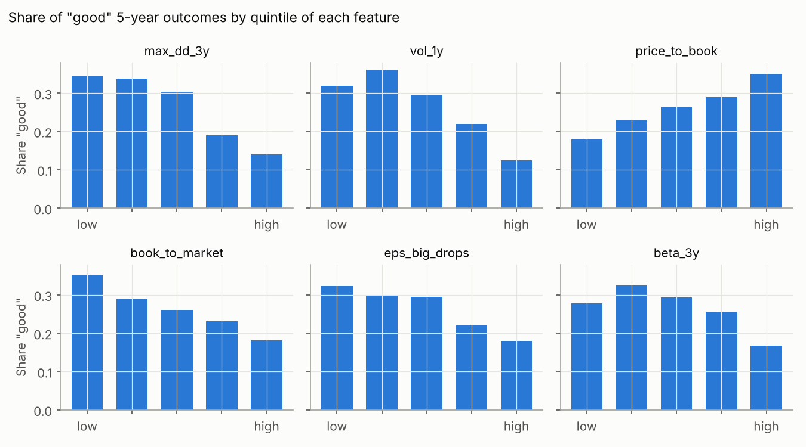
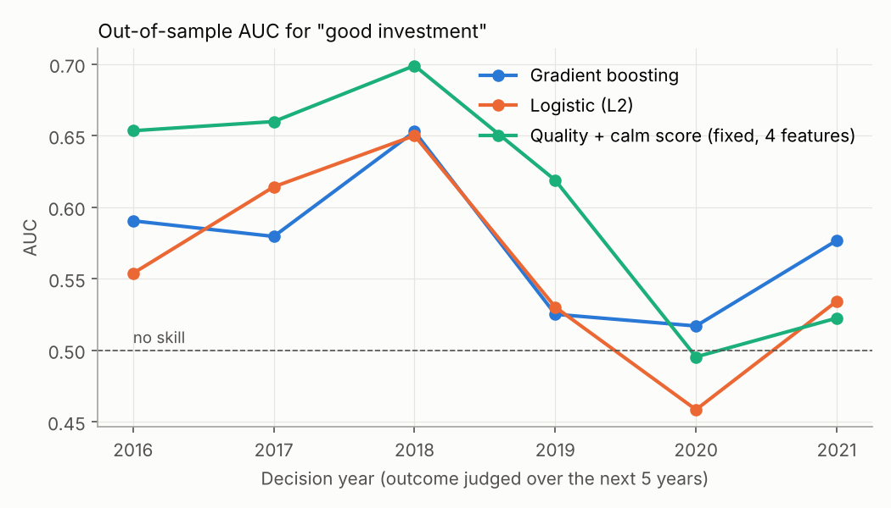
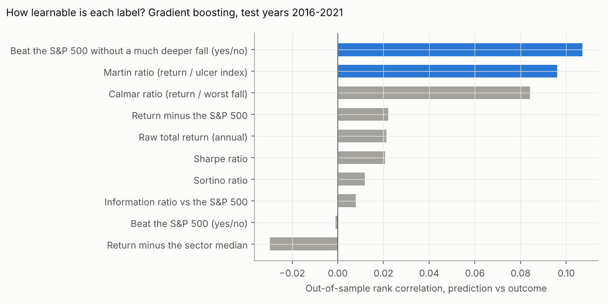
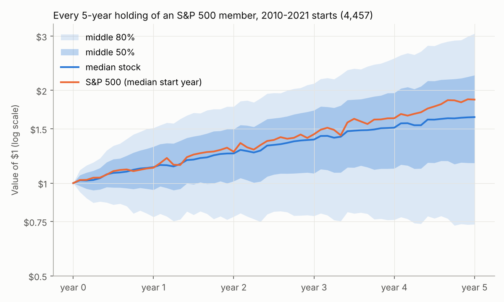
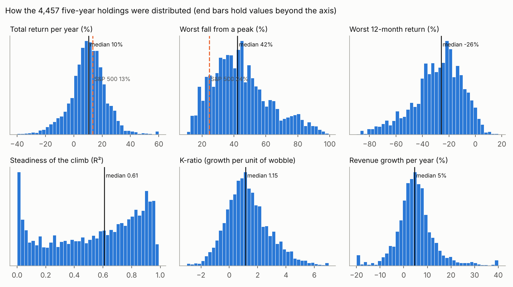
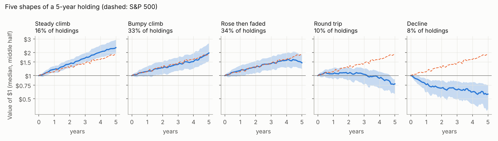
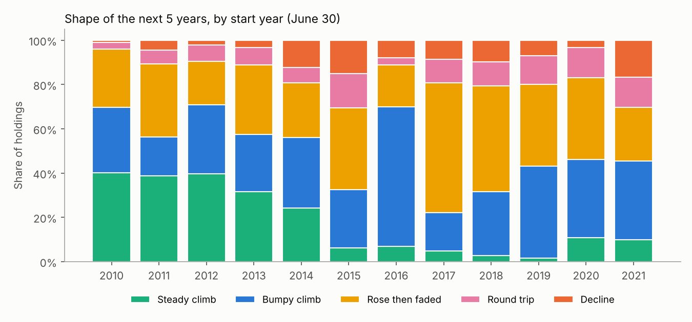

# Predictive analysis: which S&P 500 stocks grow steadily over 5 years?

*Prices through 2026-10-27; SEC filings as filed through 2026-10-27, used only as of each
decision date; S&P 500 membership through 2026-08-18. Written 2026-10-28. Issue #10.
Method: [docs/PREDICT.md](../docs/PREDICT.md).*

## 1. Summary

**Update 2026-10-28.** Babak does not want a good/bad answer: the goal is long-term,
*predictable* growth. So the output is now a continuous score of how steadily the stock
compounded over the next 5 years, tested against 11 other growth scores (section 2.6).

**Recommended label: the K-ratio, ranked within the year.** Fit a straight line through the
log of the total-return value over the 5 years; the K-ratio is the slope of that line
divided by how far the value wandered from it. It is high only when growth is both fast
and steady. Read it with three plain numbers: trend growth (%/yr), steadiness (R², 1 = a
perfectly straight climb) and the worst 12-month return the holder sat through.

- **It is predictable, every year.** Out-of-sample rank correlation 0.16 (all 7 models
  0.15–0.17, positive in all 6 test years), against 0.02 for raw return. The win rate of
  12-month periods (0.17) and steadiness R² (0.14) behave the same way.
- **The fixed "Quality + calm" score** (high return on assets, small past fall, no
  dilution, few big EPS drops; nothing fitted) ranks it with correlation 0.23, positive in
  all 12 years 2010–2021. From its lowest to its highest fifth: trend growth 8.7% → 12.0%
  a year, steadiness 0.46 → 0.72, worst 12 months −34% → −21%, time spent >10% below the
  peak 57% → 38%.
- **The speed of growth alone is not predictable** (0.00): what can be forecast is the
  steadiness, and steady stocks grew at least as fast.
- **Business growth is very predictable (revenue 0.43, EPS 0.46) but already in the
  price:** the best predictors are a high P/E and EV/EBITDA. The market prices next
  5 years' growth well, so it is a check, not an edge.
- **Weak spot:** the 2020 and 2021 cohorts (correlation 0.01–0.08), when speculative
  stocks led.

**How 5-year holdings actually behave (section 2.7).** Of 4,457 five-year holdings, the
median stock made 10.4% a year (the S&P 500 13%), 18% lost money, 38% beat the index, and
the median stock fell 42% from a peak at some point (index 24%). Only 16% were a "steady
climb" (straight path, never down 30%), and that share swings with the market: 40% for
2010–2012 starts, 2–7% for 2015–2019 starts, whose windows all contained the 2020 crash.
The best 10% of holdings made 40% of all the gains. Business growth was almost the same in
steady, bumpy and faded climbs (revenue ~5%, EPS ~9–10% a year): what separated the shapes
was mostly the market and the valuation, and only the losers had weak businesses.

Earlier recommendation, kept for reference: the yes/no label `good` (beat the S&P 500
without a fall more than 15 points deeper than the index's). It ranks stocks much like the
K-ratio but throws away how much better or worse a stock did.

## 2. The numbers

### 2.1 The data in absolute terms

| | |
|---|---|
| Decision dates | June 30 of each year, 2010–2025 (16 years) |
| S&P 500 members on those dates | 8,031 member-years, 804 different tickers |
| With complete inputs | 6,350 member-years |
| With complete inputs and a full 5-year outcome (2010–2021) | **4,457** member-years, 506 companies |
| Inputs per row | 60 numbers + sector + Lynch category |

The typical company in the labelled sample (medians of each year's usable members):

| Year | Companies | Market value | P/E | Return on assets | Next 5 years: return/yr | Worst fall | S&P 500 return/yr | S&P 500 worst fall | Share "good" |
|---|---|---|---|---|---|---|---|---|---|
| 2010 | 227 | $14.2bn | 16.0 | 4.9% | 15.9% | 31% | 17.2% | 19% | 32% |
| 2011 | 300 | $15.8bn | 18.6 | 6.0% | 11.9% | 32% | 12.0% | 18% | 39% |
| 2012 | 330 | $15.5bn | 17.3 | 6.3% | 15.3% | 30% | 14.4% | 13% | 32% |
| 2013 | 341 | $18.9bn | 20.1 | 5.9% | 11.7% | 32% | 13.2% | 13% | 26% |
| 2014 | 350 | $22.3bn | 21.9 | 6.0% | 9.2% | 35% | 10.6% | 19% | 33% |
| 2015 | 365 | $22.7bn | 21.7 | 5.9% | 6.5% | 48% | 10.6% | 34% | 32% |
| 2016 | 390 | $22.2bn | 22.8 | 5.4% | 13.3% | 46% | 17.5% | 34% | 25% |
| 2017 | 407 | $24.8bn | 24.8 | 5.1% | 8.0% | 48% | 11.2% | 34% | 29% |
| 2018 | 419 | $26.3bn | 26.1 | 5.6% | 7.8% | 49% | 12.2% | 34% | 23% |
| 2019 | 423 | $27.6bn | 23.9 | 6.0% | 8.4% | 49% | 14.8% | 34% | 16% |
| 2020 | 448 | $25.5bn | 22.5 | 6.2% | 12.1% | 42% | 16.6% | 25% | 22% |
| 2021 | 457 | $35.9bn | 34.8 | 4.4% | 6.4% | 44% | 13.3% | 25% | 17% |

The median member trailed the (market-value weighted) S&P 500 in almost every year, more
so after 2015 as the largest companies pulled ahead: on average only 27% of stock-years were
"good" and 39% beat the index at all.

Survivorship: share of each year's members with no price history (delisted, mostly acquired):

| Year | 2010 | 2012 | 2014 | 2016 | 2018 | 2020 | 2021 |
|---|---|---|---|---|---|---|---|
| Members without prices | 32% | 28% | 25% | 19% | 14% | 9% | 8% |
| Later left the index but still trade (included) | 69 | 71 | 74 | 78 | 75 | 59 | 58 |

### 2.2 The candidate labels

Ten candidate outputs, scored on five criteria (data: 4,457 labelled stock-years).

| Label | One-sentence meaning | Volatile winners* still in its top fifth | Average-by-year spread** | Persistence*** | Learnable (out-of-sample rank corr.) |
|---|---|---|---|---|---|
| Raw return | how much the stock made | 100% | high (4.9%–16.8%/yr) | 0.11 | 0.02 |
| Return minus S&P 500 | how much more than the index | 100% | low | 0.11 | 0.02 |
| Return minus sector median | how much more than its industry | 84% | none | 0.10 | −0.03 |
| Sharpe ratio | return per unit of volatility | 56% | high | 0.12 | 0.02 |
| Sortino ratio | return per unit of downside volatility | 57% | high | 0.12 | 0.01 |
| Calmar ratio | return / worst fall | 41% | high | 0.16 | 0.08 |
| Martin ratio | return / average depth and length of falls | 43% | high | **0.17** | **0.10** |
| Information ratio | excess return per unit of tracking error | 90% | low | 0.05 | 0.01 |
| Beat the S&P 500 (yes/no) | won against the index | 100% | low (25%–52%) | 0.05 | 0.00 |
| **Good (yes/no)** | **beat the index without a much deeper fall** | **0%** | low (16%–39%) | 0.10 | **0.11** |

\* Volatile winners: stocks in the top fifth by 5-year return whose worst fall was more than
15 points deeper than the index's. They are **30% of the top fifth by return** (examples:
Micron 2012 and 2013, +36%/yr and +30%/yr with a 74% fall; NVIDIA 2019, +98%/yr with a
66% fall; Royal Caribbean 2020, +44%/yr with a 68% fall; Freeport-McMoRan 2017).
\** Spread of the label's average across the 12 years; a label with a high spread mostly
measures the market of that period. Percentiles within each year remove it.
\*** Rank correlation between a stock's label in year *t* and in year *t*+5 (two separate
windows): how much the label is a trait of the company rather than luck.

All return-based labels move together (rank correlation 0.86–1.00); `good` and the drawdown
ratios are the ones that disagree with raw return where Babak wants them to.

Sensitivity of `good` to the drawdown margin:

| Margin over the index's worst fall | 0 pts | 10 pts | **15 pts** | 20 pts | 30 pts |
|---|---|---|---|---|---|
| Share of stock-years "good" | 6% | 21% | **26%** | 31% | 35% |
| Share of index-beaters kept | 17% | 55% | **70%** | 82% | 94% |
| Average worst fall of the "good" | 24% | 28% | **30%** | 31% | 33% |
| Average excess return of the "good" | 8.6% | 8.0% | **8.0%** | 8.1% | 8.2% |

### 2.3 Which inputs relate to "good" (in-sample, all 12 years)

Average within-year rank correlation with `good` (negative = lower is better); "hit" =
share of years with the same sign:

| Feature | Correlation | Hit | Share "good", lowest → highest fifth |
|---|---|---|---|
| Worst fall in the past 3 years | −0.19 | 92% | 34%, 34%, 30%, 19%, 14% |
| Volatility, past year | −0.18 | 83% | 32%, 36%, 29%, 22%, 12% |
| Price / book | +0.13 | 75% | 18%, 23%, 26%, 29%, 35% |
| Big EPS drops (>30%) on record | −0.13 | 83% | 32%, 30%, 30%, 22%, 18% |
| Beta, 3 years | −0.11 | 75% | 28%, 32%, 29%, 25%, 17% |
| Market value (log) | +0.11 | 100% | 20%, 21%, 29%, 31%, 31% |
| Price vs 52-week high | +0.11 | 92% | 15%, 28%, 30%, 30%, 28% |
| Change in share count | −0.11 | 100% | 29%, 30%, 30%, 24%, 19% |
| Return on equity | +0.10 | 83% | 20%, 22%, 30%, 28%, 31% |
| Return on assets | +0.10 | 83% | 16%, 27%, 28%, 30%, 30% |

For plain excess return the strongest consistent relations were share count change (−0.13,
every year), capex / revenue (−0.12, every year) and buyback yield (+0.11, every year). They
are consistent in-sample, but the models below could not turn them into out-of-sample gains.



### 2.4 Out-of-sample results

Walk-forward: each test year *T* (2016–2021) is predicted by models trained only on years
whose 5-year outcome was known by *T*.

**Classification of `good`** (AUC: 0.5 = coin flip; base = share good in the test years, 22%):

| Model | AUC | Years with AUC > 0.5 | Share good in top predicted fifth | Excess return/yr, top fifth vs bottom fifth |
|---|---|---|---|---|
| **Quality + calm (fixed score, 4 features)** | **0.61** | 5 of 6 | **29%** | **+3.5 pts** |
| Profitability + low drawdown (fixed, 2 features) | 0.61 | 4 of 6 | 31% | +3.0 pts |
| Gradient boosting | 0.57 | 6 of 6 | 26% | +0.9 pts |
| Random forest | 0.56 | 5 of 6 | 25% | −0.3 pts |
| Logistic regression (L2) | 0.56 | 5 of 6 | 25% | +0.5 pts |
| Decision tree, depth 3 | 0.55 | 5 of 6 | 24% | −0.4 pts |
| Logistic regression (L1) | 0.54 | 4 of 6 | 23% | −1.4 pts |
| Factor score, top 10 picked on training years | 0.54 | 4 of 6 | 21% | −2.2 pts |
| Low volatility only (fixed) | 0.55 | — | 23% | −1.5 pts |
| Return on assets only (fixed) | 0.58 | — | 29% | +3.9 pts |

Over all 12 years (possible for the fixed scores only, since nothing is fitted), Quality +
calm had AUC 0.63, top-fifth "good" rate 38% vs 27%, worst fall 37% vs 43%, and +4.2 pts a
year over the bottom fifth.

**Regression on percentiles** (rank correlation of prediction with outcome, 2016–2021):

| Target | Best model | Rank correlation | Years positive |
|---|---|---|---|
| Martin ratio percentile | random forest / gradient boosting | 0.10 | 4–5 of 6 |
| Return minus S&P 500 | factor score / OLS | 0.03 | 3–4 of 6 |
| Return minus S&P 500, 1 year (14 test years) | depth-3 tree | −0.02 (others −0.05 to −0.07) | 7 of 14 |





### 2.5 Babak's existing rules as predictors

| Group | Stock-years | Share good | Beat the index | Excess return/yr | Worst fall |
|---|---|---|---|---|---|
| Passes the strict screen | 2,225 | 29% | 42% | −2.8% | 45% |
| Fails the strict screen | 2,232 | 23% | 34% | −4.4% | 44% |
| Stayed in the index | 3,680 | 30% | — | −1.5% | 41% |
| Left the index later | 777 | 10% | — | −13.5% | 59% |

(The strict screen: cash ≥ short-term debt, cash ≥ 5% of long-term debt, net debt/EBITDA ≤
4.5, EBITDA/interest ≥ 4, profitable.)

### 2.6 Growth labels (2026-10-28)

12 continuous candidates, 4,457 stock-years (business labels fewer: they need 6 annual
reports). "Model" = out-of-sample rank correlation, 2016–2021 test years; "Quality + calm" =
rank correlation of the fixed score in all 12 years; "Persistence" = correlation of the
label with itself 5 years later; "Volatile winners" = average percentile given to top-fifth
returners that fell >15 points deeper than the index (lower = penalises them more).

| Label | What it measures | Model (GB) | Years > 0 | Quality + calm | Persistence | Volatile winners |
|---|---|---|---|---|---|---|
| `trend_growth` | growth rate of the fitted line, %/yr | 0.00 | 3/6 | 0.13 | 0.13 | 0.84 |
| `excess_trend` | trend growth minus the S&P 500's | 0.00 | 3/6 | 0.13 | 0.13 | 0.84 |
| `trend_r2` | steadiness (R² of the line) | 0.14 | 6/6 | 0.21 | 0.19 | 0.63 |
| **`k_ratio`** | **trend growth per unit of wobble** | **0.16** | **6/6** | **0.23** | **0.22** | **0.66** |
| `steady_growth` | trend growth × R² | 0.04 | 5/6 | 0.17 | 0.16 | 0.79 |
| `win_12m` | share of 12-month periods with a gain | 0.17 | 6/6 | 0.23 | 0.23 | 0.65 |
| `worst_12m` | worst 12-month return | 0.40 | 6/6 | 0.28 | 0.36 | 0.44 |
| `underwater` | share of days >10% below the peak (lower better) | 0.39 | 6/6 | −0.28 | 0.40 | 0.52 |
| `eps_cagr_fwd` | EPS growth, next 5 fiscal years | 0.46 | 6/6 | −0.13 | −0.15 | 0.72 |
| `revenue_cagr_fwd` | revenue growth, next 5 fiscal years | 0.43 | 6/6 | 0.09 | 0.20 | 0.68 |
| `eps_r2_fwd` | steadiness of EPS growth | 0.19 | 6/6 | 0.08 | 0.19 | 0.64 |
| `eps_down_years` | years EPS fell, of 5 (lower better) | 0.30 | 6/6 | −0.11 | 0.15 | 0.60 |
| `cagr` (reference) | raw return | 0.02 | 4/6 | 0.14 | 0.11 | 0.90 |
| `martin` (reference) | return per unit of drawdown pain | 0.10 | 5/6 | 0.21 | 0.17 | 0.76 |

`worst_12m` and `underwater` are the most predictable but measure risk only (a stock that
went nowhere calmly scores well); the K-ratio is the most predictable label that needs
growth too (rank correlation with raw return 0.83).

**Medians by Quality + calm fifth (all 12 years):**

| Fifth | Trend growth | Steadiness R² | K-ratio | Worst 12 months | Years up (12m) | Time >10% below peak | Return/yr | Revenue growth |
|---|---|---|---|---|---|---|---|---|
| 1 (lowest) | 8.7% | 0.46 | 0.78 | −33.5% | 63% | 57% | 8.1% | 3.3% |
| 2 | 9.7% | 0.58 | 0.98 | −28.2% | 65% | 49% | 9.2% | 4.2% |
| 3 | 11.1% | 0.61 | 1.17 | −26.2% | 69% | 47% | 10.5% | 4.2% |
| 4 | 12.1% | 0.67 | 1.39 | −22.6% | 73% | 42% | 11.8% | 4.7% |
| 5 (highest) | 12.0% | 0.72 | 1.59 | −21.0% | 76% | 38% | 12.1% | 5.8% |

Fixed-score correlation with the K-ratio by cohort: 2010 0.30, 2011 0.26, 2012 0.25,
2013 0.21, 2014 0.22, 2015 0.25, 2016 0.36, 2017 0.35, 2018 0.32, 2019 0.19, 2020 0.05,
2021 0.01. Gradient boosting by test year: 0.30, 0.29, 0.19, 0.05, 0.06, 0.08 (2016–2021).

What predicts the K-ratio (within-year rank correlation): low 1-year volatility (−0.29),
small 3-year drawdown (−0.28), price near its 52-week high (+0.18), low beta (−0.18),
size (+0.15, all 12 years), few big EPS drops (−0.15), operating margin (+0.12, all 12 years).

What predicts revenue growth: EV/EBITDA (+0.36), P/E (+0.34), price-to-sales (+0.30): the
fast growers were already expensive. Lynch's PEG idea follows: the edge would be growth
beyond what the P/E implied, a label worth testing next.

### 2.7 How 5-year holdings behave (2026-10-28)

Each of the 4,457 labelled member-years is one holding: $1 bought on June 30 and held
5 years with dividends reinvested. The S&P 500 over the same windows is the reference.



**Distribution** (`behaviour_distribution.csv`):

| Measure | 5% | 10% | 25% | Median | 75% | 90% | 95% |
|---|---|---|---|---|---|---|---|
| Total return per year | −12.6% | −6.0% | 3.1% | 10.4% | 17.5% | 25.1% | 29.7% |
| Value of $1 after 5 years | $0.51 | $0.74 | $1.16 | $1.64 | $2.24 | $3.06 | $3.67 |
| Return minus the S&P 500, per year | −25.7% | −19.5% | −10.3% | −3.3% | 4.0% | 10.8% | 15.6% |
| Worst fall from a peak | 19% | 23% | 31% | 42% | 55% | 71% | 80% |
| Worst fall minus the S&P 500's (points) | −3 | 0 | 6 | 15 | 28 | 44 | 52 |
| Volatility per year | 16% | 17% | 21% | 26% | 33% | 41% | 48% |
| Steadiness of the climb (R²) | 0.01 | 0.05 | 0.27 | 0.61 | 0.83 | 0.92 | 0.94 |
| K-ratio | −0.98 | −0.50 | 0.28 | 1.15 | 2.18 | 3.41 | 4.13 |
| Worst 12-month return | −64% | −54% | −39% | −26% | −15% | −6% | −2% |
| Share of days >10% below the peak | 10% | 15% | 28% | 46% | 66% | 82% | 90% |
| Revenue growth per year (business) | −7.1% | −3.6% | 0.7% | 4.6% | 8.5% | 14.0% | 19.2% |
| EPS growth per year (business) | −17.6% | −9.2% | 1.0% | 8.6% | 16.8% | 27.4% | 37.4% |

Value of $1 after 5 years: lost half or more 5%, lost up to half 13%, $1–1.5 25%,
$1.5–2 23%, $2–3 23%, $3–5 9%, over $5 2%. With $1 in every holding, the best 1% made
10% of the total gain, the best 10% made 40%, and the bottom half 5%.



The return distribution is roughly symmetric around 10% a year; the falls are not: the
typical stock fell 15 points deeper than the index along the way, and one in four fell
more than 55%. Steadiness is split in two: a large group climbed in a nearly straight line
(R² > 0.8) and another had no trend at all (R² near 0).

**Five shapes** (`behaviour_shapes.csv`). Each path is put in one plain shape:

| Shape | Rule | Share | Return/yr | Beat S&P 500 | Worst fall | Worst 12 months | Revenue growth | EPS growth |
|---|---|---|---|---|---|---|---|---|
| Steady climb | gained, R² ≥ 0.8, never fell 30% | 16% | 18.2% | 77% | 22% | −6% | 4.8% | 9.8% |
| Bumpy climb | gained, ended within 10% of its high | 33% | 14.5% | 51% | 39% | −22% | 4.9% | 9.1% |
| Rose then faded | gained, ended >10% below its high | 34% | 8.0% | 25% | 45% | −30% | 5.4% | 9.6% |
| Round trip | was up ≥20%, ended with a loss | 10% | −4.8% | 0% | 65% | −48% | 2.6% | 3.5% |
| Decline | lost money, never up 20% | 8% | −10.5% | 0% | 70% | −52% | 0.9% | −3.9% |



**By start year** (`behaviour_by_cohort.csv`, `behaviour_shapes_by_cohort.csv`):

| Start | Holdings | Median return/yr | S&P 500 | Lost money | Beat S&P 500 | Median worst fall | S&P 500 worst fall | Steady climbs |
|---|---|---|---|---|---|---|---|---|
| 2010 | 227 | 15.9% | 17.2% | 4% | 44% | 31% | 19% | 40% |
| 2011 | 300 | 11.9% | 12.0% | 11% | 49% | 32% | 18% | 39% |
| 2012 | 330 | 15.3% | 14.5% | 9% | 52% | 30% | 13% | 40% |
| 2013 | 341 | 11.7% | 13.3% | 11% | 45% | 32% | 13% | 32% |
| 2014 | 350 | 9.2% | 10.6% | 19% | 44% | 35% | 19% | 24% |
| 2015 | 365 | 6.6% | 10.6% | 30% | 36% | 48% | 34% | 6% |
| 2016 | 390 | 13.3% | 17.5% | 11% | 35% | 46% | 34% | 7% |
| 2017 | 407 | 8.0% | 11.2% | 19% | 38% | 48% | 34% | 5% |
| 2018 | 419 | 7.8% | 12.2% | 21% | 32% | 49% | 34% | 3% |
| 2019 | 423 | 8.4% | 15.0% | 20% | 25% | 49% | 34% | 2% |
| 2020 | 448 | 12.1% | 16.6% | 17% | 35% | 42% | 25% | 11% |
| 2021 | 457 | 6.4% | 13.3% | 30% | 28% | 44% | 25% | 10% |



**By sector** (median, all years; `behaviour_by_sector.csv`):

| Sector | Holdings | Return/yr | Beat S&P 500 | Worst fall | Steadiness R² | K-ratio | Steady climbs |
|---|---|---|---|---|---|---|---|
| Utilities | 301 | 9.2% | 26% | 31% | 0.71 | 1.56 | 28% |
| Technology | 600 | 15.6% | 55% | 42% | 0.69 | 1.46 | 16% |
| Consumer staples | 361 | 9.8% | 34% | 32% | 0.69 | 1.37 | 27% |
| Industrials | 721 | 12.2% | 44% | 41% | 0.65 | 1.32 | 15% |
| Health care | 444 | 10.7% | 41% | 39% | 0.69 | 1.31 | 21% |
| Financials | 615 | 11.2% | 37% | 44% | 0.59 | 1.18 | 16% |
| Consumer discretionary | 583 | 9.7% | 38% | 49% | 0.58 | 0.97 | 12% |
| Communication | 72 | 4.9% | 21% | 38% | 0.51 | 0.85 | 14% |
| Materials | 261 | 8.1% | 32% | 48% | 0.46 | 0.78 | 10% |
| Real estate | 254 | 6.4% | 19% | 44% | 0.42 | 0.75 | 11% |
| Energy | 191 | 4.2% | 23% | 66% | 0.37 | 0.24 | 4% |

**Does a shape repeat?** For the same company, the shape of the next non-overlapping
5 years (`behaviour_shape_persistence.csv`): after a steady climb, 9% climbed steadily again
against 6% for all holdings starting 2015 or later; after a round trip, only 2% did. The
shape carries over a little, but the market in the window matters more.

What it means for long-term predictable growth:

- **A steady climb is rare and mostly a gift of the period.** In the 2010–2012 starts 40%
  of members climbed steadily; once the 2020 crash fell inside every window, almost none
  did, because the index itself fell 34%. Judge steadiness against the index of the same
  years (as the K-ratio percentile does), not in absolute terms.
- **The business grew at about the same pace in the three winning shapes** (revenue ~5%,
  EPS ~9–10% a year). Whether the price climbed steadily, bumped or faded depended on the
  starting valuation and the market; only the two losing shapes had weak businesses
  (EPS −4% to +4%). Avoiding the losers is about the business; getting the steady climb is
  about the price paid and the period.
- **The gains are concentrated:** the top 10% of holdings made 40% of the gains, so a few
  big winners drive any average. A steady-growth approach gives up some of those in return
  for far fewer of the 18% that lost money.
- **Sectors differ in steadiness more than in return:** utilities and staples were the
  steadiest but trailed the index; technology was both fast and fairly steady in this
  decade; energy was the least steady by far.

Caveat: holdings of companies later delisted (mostly acquired) are missing, so the
losing shapes are probably undercounted and the winning ones slightly flattered.

## 3. Analysis

### 3.1 Why this label

Babak's requirement: the output must say plainly whether buying at *t* was a good idea, and
a stock that rose a lot through a crash must not count, because the same kind of company
often lost a lot instead. Five criteria follow from that:

1. **Interpretable in one sentence.** Binary labels win: "beat the S&P 500 without falling
   much harder than it". Ratios like Sortino or Martin need a definition.
2. **Penalises the volatile winner.** Raw and relative returns, the information ratio and
   "beat the index" all keep 84–100% of volatile winners at the top. Sharpe and Sortino keep
   more than half. Only drawdown-based measures push them down, and `good` excludes them by
   construction.
3. **Free of the market regime.** Raw return and the ratios swing with the market of the
   period (the 2015 cohort made 4.9%/yr, the 2010 cohort 16.8%). Anything measured against
   the index on the same days (excess return, `good`) or ranked within the year is stable.
4. **Measures the company, not luck.** Martin and Calmar are the most persistent (0.17 and
   0.16 between non-overlapping windows); `good` is middling (0.10), index-relative returns
   lowest. Return differences between large stocks over 5 years are mostly noise.
5. **Learnable from what is known on the day.** Only labels that include drawdowns are
   learnable at all, because risk persists and return does not.

Why not the alternatives:
- *Raw return* fails criteria 2 and 3: it is the "volatile winner" problem Babak described.
- *Return vs the market or sector* is regime-free but still rewards volatile winners and is
  not predictable (≈ 0.02).
- *Sharpe/Sortino* penalise volatility only mildly and are regime-dependent.
- *Calmar* uses one single worst day, so it is noisier than Martin, which averages all
  drawdowns.
- *Quantile labels* (top fifth vs the rest) are just thresholds on any of the above; we use
  within-year percentiles for the continuous companion.
- *Probability of beating the index with a drawdown below X* is exactly what a classifier
  trained on `good` estimates, so `good` covers it. An absolute drawdown limit (e.g. 40%)
  was rejected because in some periods the index itself fell 34%.

The cost of the choice, stated plainly: `good` says no to NVIDIA bought in June 2019
(+98% a year, but a 66% fall in 2022 against the index's 25%). That is Babak's rule applied
as stated; the Martin percentile still ranks that case at 99%, which is why both are kept.
The margin of 15 points is a judgement: it keeps 70% of index-beaters and the results do
not change much between 10 and 20 points.

### 3.2 What predicts "good", and how much

- **Risk carries over, return does not.** The strongest inputs are the stock's own past
  drawdown and volatility: the calmest fifth was "good" 34% of the time, the most volatile
  fifth 12–14%. Past volatility predicts future drawdown very reliably (rank correlation
  0.53 with the next 5 years' worst fall, positive in all 12 years), but says almost
  nothing about future return.
- **Quality is the second ingredient.** Return on assets and equity, few big EPS drops and
  no share dilution all point the same way, every year or nearly. Companies that issue
  shares or spend heavily on capex relative to revenue did worse; buybacks did better.
- **Cheapness did not help** in this period. Higher price-to-book went with *more* good
  outcomes (35% in the most expensive fifth vs 18% in the cheapest), and earnings yield had
  no reliable relation. 2010–2026 rewarded expensive quality and growth; a value-friendly
  decade could reverse this. Peter Lynch's habit of combining quality with a fair price is
  not contradicted: price matters, but it did not *rank* S&P 500 members here.
- **Size helped** (larger members were good more often), consistent with the mega-cap decade.
- **Machine learning added nothing beyond a few factors.** With 6 test years and at most
  ~4,000 training rows, flexible models fit the patterns of their training years, which
  changed. A 4-feature equal-weight score was better and is fully readable.
- **The signal is weak and not stable.** AUC around 0.6 means: pick two stocks, one that
  turned out good and one that did not, and the score ranks the good one higher 6 times in
  10. It failed for the 2020 and 2021 cohorts, where the 2022 bear market and the AI rally
  hit the calm, profitable stocks' relative performance.
- **Short horizons are worse.** At 1 year no model beat chance; most were slightly negative.

### 3.3 Caveats

- **Survivorship.** Using each year's actual members brings back the index leavers that
  still trade, and they matter (10% good vs 30%). Delisted companies (8–32% of members,
  mostly acquired, often at a premium) have no free price history and are missing. The bias
  can go either way; it is largest in 2010–2013. A paid source of delisted prices would fix it.
- **Few independent periods.** Five-year windows overlap: 12 decision years contain only
  about three independent 5-year periods, and all of them sit inside one long bull market
  (2010–2026). Treat every number here as an estimate with wide error.
- **Feature choice for the fixed score.** The four features were picked from factors known
  in the literature (profitability, low risk, net share issuance, earnings stability) and
  confirmed in-sample; that is a mild form of hindsight. The walk-forward "factor score",
  which picks features only from past years, did worse (AUC 0.54).
- **Data gaps.** Annual 10-K figures only (no trailing 12 months), GAAP EPS rather than
  adjusted, a sector mapping from SIC codes, a simplified Lynch category, and ~2% of rows
  dropped for share-count errors. Calibrated probabilities are poor (negative Brier skill)
  because the share of good stocks fell from ~35% in 2010–2012 to ~17% in 2019–2021; use
  the scores as rankings.
- **Benchmark.** The S&P 500 is weighted by market value; the median member trailed it by
  ~4 points a year. An equal-weight benchmark would make many more stocks "good".

### 3.4 Next steps

1. Babak to confirm the K-ratio as the label (read with trend growth, R² and worst
   12 months); test "growth beyond what the P/E priced" (a PEG-style label) next.
2. Add trailing-12-month figures from 10-Qs and Yahoo adjusted EPS history, then rerun.
3. Extend the universe to the Russell 1000 or US + Europe > $1bn (more rows, more variety);
   quarterly decision dates would add rows but not independent periods.
4. Get delisted prices (one paid month of EODHD or Norgate) to close the survivorship gap.
5. If the label is confirmed, show the Quality + calm percentile next to each stock in the
   screener (a filter, not a pick); this needs Babak's go before it touches the nightly run.

### 3.5 Reproduce

```
uv run python analysis/predict.py all      # ~25 minutes the first time
uv run python analysis/predict.py models   # experiments only, ~3 minutes
uv run python analysis/predict.py behaviour  # distributions and path shapes, ~1 minute
```

Every table above is in `data/predict/results/` (`label_*.csv`, `ic_*.csv`, `quintiles_*.csv`,
`wf_summary_*.csv`, `growth_labels.csv`, `growth_by_quality_calm.csv`, `behaviour_*.csv`, `fixed_scores_y5*.csv`, `strict_screen_y5.csv`, `leavers_y5.csv`,
`coverage.csv`); the panel is `data/predict/panel.csv.gz`.

*Nothing in this report is investment advice.*
